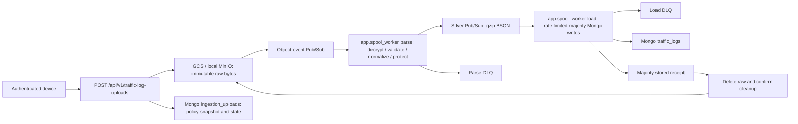

# Implementation status

## GCP deployment

Terraform uses direct Cloud Run HTTPS ingress for the frontend and API, with
distinct generated URLs and no load balancer or custom domain. Frontend API calls
remain server-side; Auth0 still protects the API, and parser/loader workers stay
internal. `public_url` and `backend_url` are available after the foundation apply
for Auth0 callback and agent configuration. See the
[deployment guide](../infra/gcp/README.md) for prerequisites and verification.
`make gcp-secrets-bootstrap` initializes missing Secret Manager values only,
preserves existing versions on rerun and reports numeric versions for Terraform.
Generated keys stay in memory; supplied credentials use hidden prompts or private files.

## Ingestion

The sole ingestion pipeline is:

- `POST /api/v1/traffic-log-uploads` returns `202` after raw durability, not content
  validation. The response has `upload_id`, `status=received`, `duplicate=false`,
  and no event count. Workers can advance state before POST returns.
- Optional device-scoped `X-Batch-Id` makes identical-byte/format retries return
  `200` with `duplicate=true`; conflicting reuse returns `409`. Receipts have no
  TTL. Without the header each request creates a new upload.
- `GET /api/v1/traffic-log-uploads/{upload_id}` reports status, nullable
  `accepted_count`, sanitized `error_code`, and `raw_deleted`. Agents see only
  their device; `manage:devices` permits fleet status reads. These are operational
  primary reads, not analysis reads.
- Authentication, media/wire limits, attribution and device transfer policy are
  synchronous. JWE, gzip, JSON and record validation fail asynchronously, before
  publishing any documents to silver.
- Raw is a temporary replay source, not a historical lake. Original bytes can
  include values later discarded by workspace policy. Parser processing uses the
  acceptance-time policy snapshot. Use synthetic data in local MinIO; its volume
  does not promise production encryption at rest.
- GCS finalization produces object-event Pub/Sub notifications. Locally, real
  MinIO notifications reach a private bridge and Pub/Sub emulator. Receipt
  polling/bucket listing is not the normal processing trigger.
- `app.spool_worker parse` performs upload cryptography, bounded decompression,
  schema validation, normalization, minimization and field protection.
  `app.spool_worker load` needs no EC keys or KMS credential.
- Silver is gzip BSON with bounds of **9,500,000 wire bytes / 32 MiB expanded**.
  Oversized protected output fails parsing with `silver_payload_too_large` and
  retains raw.
- Loader rate is `SPOOL_MONGO_DOCUMENTS_PER_SECOND` per replica, with at most a
  one-batch initial burst (500 documents). It waits for capacity before pulling.
- Both hops pull bounded work and explicitly ACK; deadlines recover crashed
  consumers. Atomic stage claims and expiring receipt leases prevent ordinary
  competing writes. Deterministic event IDs and missing-ID checks support replay.
  Mongo time-series cannot enforce unique measurement IDs or atomically commit
  measurements with the receipt: ambiguous writes can duplicate records.
- Both workers default to three application attempts. Terraform configures native
  Pub/Sub redrive at five delivery attempts and configurable 14-day retention.
  Failed DLQ publication leaves work unacknowledged.
- Application dead letters contain sanitized pointers. Native load redrive can
  contain protected normalized documents, including intentionally plaintext fields.
  Restrict both DLQs and inspection subscriptions; never log message bodies.
- Delete raw only after majority Mongo writes and a majority `stored` receipt.
  Cleanup failures and ambiguous late object recreation retry deletion without
  loading again. Pending/failed raw has no automatic TTL; the dedicated bucket
  has no versioning or soft deletion.
- `python -m app.spool_worker replay <upload_id>` retries retained raw after
  repairs and refuses active leases. `cleanup <upload_id>` handles stored uploads
  with pending cleanup. Message expiry does not delete raw.

See [README](../README.md#core-ingestion-flow) and
[runbook](RUNBOOK.md#upload-ingestion) for contracts, metrics and recovery.

## Identity and management

- Auth0 token verification uses the official `Auth0FastAPI.require_auth()`,
  configured tenant/audience and SDK discovery/JWKS caching. RS256, required
  claims, sanitized failures and Bearer challenges are enforced. Unexpected SDK
  failures return `503`; login/token issuance stays with Auth0.
- The JWT device claim, or `sub` fallback, supplies globally unique device
  identity. Verified `azp`/`client_id` supplies optional OAuth attribution.
  The ASGI peer after trusted-proxy handling supplies upload source IP.
  Agent observations cannot override those fields.
- Agents access only their JWT-bound device; `manage:devices` permits fleet
  management/reads. Status acknowledgements still require matching agent identity.
- Device registration atomically stores name, server-generated timestamp and
  initial policy. Unique IDs/names, including concurrent conflicts, return `400`
  without overwriting. Policy changes use expected versions and return `409`
  for stale edits. Registration does not issue credentials or change JWT identity.
- Device inventory includes unnamed/version-zero agent/policy records.
  Configuration and acknowledgement APIs are primary/majority-backed.
- HTTPS enforcement and narrowly trusted forwarded-proxy settings are implemented.
  Health/OpenAPI access is not a persistence-readiness guarantee.

## Encryption and workspace policies

- Application encryption uses JSON -> gzip -> compact JWE with configured
  ECDH/AES suites (default P-384, ECDH-ES+A256KW, A256GCM), retained rotation keys,
  strict headers and bounded processing.
- OpenBao Transit wraps EC key sets under a non-exportable KEK; KV v2 stores
  ciphertext with CAS. EC keys are unwrapped into process RAM for local JWE/ECDH.
  No plaintext EC key files or private EC Kubernetes Secrets are used.
- CLI operations cover initialization, staged EC rotation/activation/retirement,
  KEK rotation/rewrapping and independent storage-key rotation. Keep keys needed
  by retained logs and all pending/failed raw uploads; restart parser processes
  as well as API instances after key-set changes.
- Workspace storage settings independently select discard, retain encrypted
  (default), or retain plaintext for bodies, authorization headers and cookies.
  Discard precedes field KMS/silver publication, removes selected header entries,
  and preserves body length/SHA-256. Policy edits affect future uploads only.
- A separate non-exportable OpenBao AES-256-GCM storage key uses random 96-bit
  nonces and record/device/batch associated data. KMS failures fail closed.
  Authorized detail reads decrypt retained bodies; collections omit bodies and
  credential values remain redacted in all API responses.
- Workspace GET/PATCH requires `manage:devices` and uses versioned primary-backed
  configuration. Saves validate KMS only for encrypted-retention categories.
- Ordinary retention defaults to 7 days; suspicious retention defaults to 30.
  Independent disable switches mean indefinite storage. Whole-day windows are
  1–24855. MongoDB 7+ partial TTL indexes on event time filter metadata category,
  with no collection-wide TTL.
- Startup/save reconciles TTL indexes, rebuilding changed indexes on MongoDB 7.
  Settings and DDL are not atomic; failure leaves desired policy saved, returns
  `503`, and needs retry/startup reconciliation. Expiration is asynchronous and
  bucket-based. It applies to existing records and is irreversible.
- New records have server-owned `metadata.suspicious=false`; agents cannot set it.
  The analysis/classification job and supported per-record rewrite workflow are
  not implemented.

## Persistence and analysis

- Runtime persistence uses native async PyMongo with awaited shutdown; HTTP
  clients use HTTPX2. Motor is not required.
- `traffic_logs` is time-series (`timestamp`, `metadata`, seconds granularity).
  Metadata holds device/classification, `ingestion` holds trusted provenance,
  and `logdata` holds captured HTTP/network/process fields and body fingerprints.
- Indexed event-time/ID keyset pagination and ingestion batch/record lookup
  support analysis and replay. HTTP read responses remain flat.
- Closed gzip/JWE event schemas reject duplicate/unknown fields, unsafe header
  keys, invalid network values/types and oversized fields. Captured text remains
  untrusted data, never executable query/HTML.
- Writes use primary/majority. Deployment analysis strictly uses secondaries
  with majority read concern and never silently falls back. Missing secondaries
  return `503`; replication lag can temporarily hide new records.
- Single-node development explicitly enables guarded primary analysis.
  Replica-set URIs are mandatory; direct connections are rejected.

## Frontend

- Root `frontend/` is a JavaScript/JSX Next.js SSR console with Tailwind/shadcn/ui.
  Auth0 sessions and API tokens remain server-side; there is no browser token API.
- Screens cover sample overview metrics, filtered/paginated traffic, request
  details, named device registration/inventory, dedicated device detail/policy
  and acknowledgement, workspace storage/encryption/retention, and verified identity.
- Forms work without JavaScript, reject stale combined policy edits, and render
  captured values as escaped text. Overview counts are samples, not aggregation.
  Saved policy/registration is not proof of an online or upgraded agent.
- There is no raw-upload or DLQ management screen.

## Local and deployment operation

- The sidebar Status page renders a responsive, server-rendered eight-stage
  ingestion diagram. `/api/v1/status` requires `manage:devices`, probes bucket,
  subscription and Mongo metadata/read access, and uses shared per-instance
  worker heartbeats with staleness/TTL handling. Local and GCP use the same
  implementation; missing signals are unknown/unavailable. Receipt counts are
  distinct from native Pub/Sub/DLQ depth. Terraform includes scoped probe IAM.

- `make dev-up` starts MongoDB/OpenBao/NGINX plus MinIO/emulator/bridge and
  provisions object events. `make spool-dev-up` is a convenience setup target.
  One Compose file defines all services, with development/spool/proxy/tool profiles.
  Native Linux selects `PROXY_SERVICE=proxy-host`; shutdown covers all profiles.
  `make dev` also starts host API/parser/loader; `make spool-parser` and
  `make spool-loader` run workers separately. API reload does not reload workers.
  `make dev` supplies `SPOOL_DEV_ENV` local connection settings; individual process
  commands use `.env`, whose example defaults to local MinIO/emulator.
- NGINX provides shared origin 8080; API/frontend use loopback 9090/3000,
  Mongo 28017, OpenBao 28200, MinIO 29000/29001 and emulator 28681.
  Docker Desktop uses the host gateway; native Linux selects the host-network service.
- Mongo/MinIO volumes persist. Development OpenBao and the emulator are ephemeral.
  Lost OpenBao keys make dependent ciphertext unreadable; rebootstrap cannot recover
  it. Emulator restart needs resource provisioning and replay of outstanding raw.
- Helm always deploys independently scalable parser/loader workers plus the API
  and optional frontend. Cloud object/Pub/Sub/IAM resources are external to Helm;
  object settings remain under `spool.*`, including lease configuration.
  Development values contain illustrative cloud names for linting, not emulators:
  override them with real resources/workload identity. Docker supplies local test
  MinIO/emulator services, not Helm.
- API/frontend/workers use hardened non-root settings and resource limits.
  Frontend has a bounded writable cache, no service-account token and no
  Mongo/OpenBao credentials. Its own existing Auth0 Secret is required when enabled.
- Production chart defaults require external Mongo and persistent HTTPS OpenBao.
  Development can bundle a three-member Mongo StatefulSet/PVCs/bootstrap Job and
  ephemeral OpenBao with isolated root credentials, TokenReview RBAC and bootstrap.
  Enforcing NetworkPolicy support is required. Bundled Mongo has no auth/TLS.
- Optional path-preserving Ingress needs an external controller, DNS/TLS and
  trusted gateway addresses. SSR uses the reachable public HTTPS origin by default.
- GCP Terraform always provisions raw storage and Pub/Sub, four workload identities
  (backend/frontend/spool-parse/spool-load), scoped IAM, DLQ/backlog alerts and
  configurable subscription retention. `deploy_services` gates Cloud Run services.
  Parser retains the cloud KMS/Secret Manager adapter; loader has no EC/KMS access.

## Test inventory

- Upload durability, original bytes, auth/device isolation, wire bounds, retry-ID
  duplicates/conflicts, policy snapshots and asynchronous gzip/JWE failures
- Deterministic replay, atomic leases, partial Mongo writes, both DLQs,
  failed-DLQ non-ACK, bounded silver compression/expansion and publication failures
- Post-majority raw cleanup, cleanup retries without loading again and late raw
  recreation; GCS conditional operations use mocked SDK calls
- Optional real MinIO notifications -> emulator object/silver hops -> Mongo ->
  raw deletion using `MINIO_TEST_ENDPOINT`, `MONGO_TEST_URI`,
  `PUBSUB_EMULATOR_HOST` and local spool configuration
- Real Mongo indexes/time-series/partial TTL, startup races, CAS/registration
  concurrency, replica routing/visibility, pagination and no primary fallback
- Real Auth0 SDK signature/claim/algorithm validation with mocked discovery/JWKS;
  live tenant/grant validation remains deployment work
- Encryption suite alternatives, retained-key behavior, JWE integrity, HTTPS,
  KMS permission denials, wrapped-only CAS, real OpenBao rotation/unwrap and
  encrypted ingestion; administrative service tests isolate their own resources
- SSR adapter tests, JavaScript-disabled browser forms and opt-in real API/Mongo
  browser tests; Helm lint/render/smoke and isolated install/upgrade/PVC checks
- HTTP-only two-device OAuth stack tests use dedicated ignored test credentials,
  verify protected/plain uploads, persisted analysis and policy/identity isolation
- Deprecation warnings fail tests except the exact upstream Auth0/Authlib JOSE
  import warning, which remains visible.

## Open items

- Measure upload ACK and `stored_observed` latency with
  `integration_tests.benchmark_ingestion`; unit/emulator tests prove no production
  p50 or speedup.
- Verify live GCS event latency, IAM, quotas, backlog/DLQ alerts and incident
  notification channels in staging. Mock Terraform does not validate live cloud.
- Approve failed-raw escalation/deletion procedures; provision production Mongo,
  persistent KMS, credentials/TLS/networking/backups and recovery.
- Validate real Auth0 tenant/grants, frontend callback/logout URLs and public
  HTTPS SSR reachability; scope `manage:devices` to intended operators.
- Implement polling/encryption in external agents and design suspicious
  classification around Mongo time-series update limits and ordinary TTL.
- If EC keys must never enter process RAM, choose a remote ECDH-capable service
  or redesign the protocol; OpenBao Transit does not offer ECDH JWE decryption.
