# Implementation status

## Current status
- **Storage and encryption** offers independent discard, retain encrypted (default)
  and retain plaintext choices for request bodies, authorization headers and
  cookies. Strict `retain_*` settings default to true and are preserved when
  omitted by existing clients. Discard happens before KMS/publishing, removes
  credential/cookie entries from both header maps, and preserves body length/digest
  metadata. Existing logs remain unchanged. Workspace saves validate KMS only
  for categories configured for encrypted retention.
- Workspace configuration includes independent enabled retention windows for
  ordinary logs (7 days) and suspicious logs (30 days). MongoDB 7+ partial TTL
  indexes on event time expire each metadata category independently; disabled
  means indefinite. Startup/save reconcile indexes, rebuilding changed TTL
  indexes on MongoDB 7 and reporting failures explicitly. Changes affect existing
  logs, with asynchronous bucket/monitor delay and irreversible-deletion warnings.
  New records have a server-owned `metadata.suspicious=false`, exposed as
  `suspicious` in analysis responses. Agents cannot supply this flag.
  The future analysis job/classification workflow is intentionally not implemented.
- Root-level `frontend/` implements a Next.js SSR management dashboard using
  JavaScript/JSX, Tailwind and shadcn/ui. Auth0 sessions/API tokens stay server-side.
  Screens cover sample overview metrics, filtered/paginated traffic, request
  details, named device registration/inventory, policy management and acknowledgement,
  application-wide storage encryption settings, and verified device identity.
  Registration and initial policy are saved atomically;
  IDs and names are globally unique and duplicates return 400. Management tokens
  can administer the fleet; ordinary agents remain restricted to their JWT device.
- Project structure initialized.
- Core FastAPI app skeleton created.
- API, service, publisher, and persistence layers are implemented.
- Auth0 token verification delegates to the official `Auth0FastAPI.require_auth()`
  dependency, using configured tenant/audience and SDK discovery/JWKS caching.
  Bearer challenges and sanitized errors are preserved; unexpected SDK failures return 503.
- Persistence uses native async PyMongo with awaited client shutdown. Runtime/test
  HTTP clients use HTTPX2; Motor is not required. The requested Auth0 SDK currently
  depends on deprecated `authlib.jose`; this upstream import warning remains visible.
- Versioned identity, gzip-batch ingestion, and log collection/item analysis endpoints
  use verified Auth0 bearer tokens. Login/token issuance remains delegated to Auth0.
- Device registration uses `POST /api/v1/devices` with `manage:devices`, a server-owned
  registration timestamp and unique ID/name constraints. Inventory collection/item reads
  are device-authorized and primary-backed; registration does not issue credentials or
  change the JWT-bound ingestion identity. Existing policy-only agents remain supported.
- Traffic logs are normalized, redacted, and persisted with server-owned attribution.
  Verified JWT claims supply device and optional OAuth client identity;
  the ASGI connection supplies source IP after trusted-proxy handling. Batch
  schemas reject client attribution fields, including inside JWE payloads.
  `/me` exposes the JWT-bound device used for ingestion policy enforcement.
- MongoDB time-series storage buckets by device and suspicious classification and supports indexed
  event-time queries with keyset pagination.
- Writes use primary with majority acknowledgement; deployment analysis uses strict
  secondary reads. Single-node local development explicitly enables primary analysis,
  guarded against use outside development.
- A replaceable ingestion publisher decouples the HTTP boundary from storage; the MVP
  writes directly to MongoDB rather than running a broker.
- Local development uses MongoDB/OpenBao Compose and host Python with Uvicorn reload;
  backend edits do not require image rebuilds. One self-initializing MongoDB container
  uses loopback port 28017; Python uses 8001. Both load the same parameterized `.env`.
- Development OpenBao uses loopback port 28200, generated private credentials,
  automatic bootstrap, and a separate least-privilege runtime token. Its dev-mode
  storage is ephemeral: restarting it loses keys, unlike MongoDB's persistent volume.
- Kubernetes API/MongoDB pod ports and the separate local port-forward are configurable.
- Helm deploys the API to Kubernetes with hardened pod settings, resource limits,
  health probes, and a ClusterIP Service.
- Default chart values require an existing Secret for external MongoDB; development
  values opt into a persistent three-member MongoDB StatefulSet and bootstrap Job.
- The bundled development database has a headless Service and ingress NetworkPolicy;
  it has no authentication/TLS and must not be used in production.
- Request bodies, authorization headers and cookies are retained with default-on
  workspace field encryption. A dedicated non-exportable OpenBao Transit AES-256-GCM
  key, separate from upload keys/the KEK, uses random 96-bit nonces and record-bound
  associated data. Body length and SHA-256 are also retained for correlation.
  Explicit plaintext choices permit future unencrypted storage; discard choices
  remove the selected fields before persistence. Existing logs are unchanged.
  Versioned workspace GET/PATCH operations require `manage:devices` and use primary.
  Replica-backed detail reads decrypt bodies; collections omit bodies and all
  credential header responses remain redacted. KMS failures fail closed.
- HTTP events retain timestamp/method/URL/status, redacted request/response headers,
  captured endpoints/ports, HTTP version, sizes, duration, process name/PID and request ID.
  Optional observations remain untrusted and distinct from JWT/network attribution.
  New documents use `request_headers`; historical `headers` remains readable.
  Gzip/JWE share closed, typed, bounded validation with duplicate-JSON-key and unsafe
  header-key rejection; invalid records reject the entire batch before publishing.
- Security-oriented defaults and redaction rules have been documented.
- Device policy/status APIs implement device-scoped configuration, permission-gated
  changes, atomic versions, and client capability/error reporting.
- JWE application encryption uses configured ECDH/AES suites (default NIST P-384,
  ECDH-ES+A256KW and A256GCM) with bounded decrypt/gzip
  processing, retained rotation keys, and policy enforcement before publishing.
- HTTPS enforcement and trusted-proxy configuration are implemented.
- OpenBao Transit protects generated EC key sets with a non-exportable KEK; only
  ciphertext is stored in KV v2. Backend RAM holds unwrapped EC keys for local
  JWE/ECDH decryption. Plaintext EC files/private EC Secrets are not used.
- CLI operations support initialization, staged EC rotation/activation, retirement,
  and KEK rotation/rewrapping, with compare-and-swap updates and no private-key output.
- Helm supports external HTTPS OpenBao with Kubernetes auth or a runtime token
  Secret and optional custom CA. The development profile includes ephemeral OpenBao,
  TokenReview RBAC, bootstrap Job, and root credentials isolated from API pods.

## Open items
- design the trusted per-record suspicious-classification job around MongoDB
  time-series update constraints and ordinary TTL deadlines; it is not included
  in the retention implementation
- replace placeholder Auth0 domain and audience values with a real tenant configuration
- validate the token flow against a real Auth0 API and permission grant
- validate MongoDB behavior against production-scale retention and query requirements
- implement durable broker/consumer infrastructure and external idempotency before
  enabling queue retries; partial bulk-write failures and client retries can duplicate records
- provision production MongoDB credentials, TLS, networking, and operational monitoring
- refine logging and redaction policies for production traffic data
- implement the documented polling/encryption protocol in external agent clients;
  provision keys and grant Auth0 `manage:devices` only to intended administrators
- provision persistent production OpenBao, TLS, audit devices, backups, recovery,
  and namespace/ServiceAccount/audience-bound authentication
- if EC keys must never enter backend memory, select a remote ECDH-capable service
  or redesign the client protocol; OpenBao Transit does not offer ECDH JWE decryption

## Test inventory
- Field discard tests cover independent categories, mixed-case request/response
  headers, preserved body fingerprints, no KMS call for discarded values, legacy
  omitted settings, and historical record readability. Real API/MongoDB checks
  verify discarded values are absent from storage; JavaScript-disabled workspace
  browser tests persist discard/encrypted/plaintext choices.
- Strict retention configuration, permission/version handling, legacy classification,
  read-back flags and rejection of agent-assigned suspicious status
- Real MongoDB partial TTL deletion of old ordinary/legacy and suspicious records,
  preservation under longer suspicious/disabled ordinary windows, changed windows,
  independently removed indexes and startup reconciliation
- JavaScript-disabled workspace browser form persists independent windows/enabled
  states and rejects stale combined encryption/retention edits
- API surface and normalized/redacted batch persistence
- gzip batch validation, size limits, trusted attribution, and publisher replacement
- Signed-JWT ingestion attribution, device-claim fallback/rejection, forbidden
  payload metadata, IPv4/IPv6/missing peers and trusted/untrusted proxy forwarding
- JWT device-scoped analysis, operator fleet reads, filter validation, and timestamp/ID pagination
- Global ID/name uniqueness under concurrent registration and duplicate HTTP 400
- explicit ingestion/read failures and replica-set connection constraints
- time-series initialization, startup races, invalid collection options, and routing
- optional real replica-set integration test: time-series indexes and inserts,
  primary/secondary command routing, replica visibility, pagination, and no primary fallback
- Signed JWT checks exercise the real Auth0 SDK against mocked discovery/JWKS,
  including signature/algorithm and claim rejection, cached keys, bearer challenges,
  and sanitized unexpected SDK failures (real tenant validation pending)
- Deprecation and pending-deprecation warnings fail tests, except the exact upstream
  Auth0/Authlib JOSE import warning, which is reported in the warning summary
- Helm lint/render validation for external and bundled MongoDB profiles, plus a
  Helm smoke-test pod checking the deployed Service and OpenAPI routes
- Isolated Kubernetes validation covers development install/upgrade, external-Secret
  deployment, real time-series/replica integration, and PVC/Secret retention on uninstall
- Local development validation covers MongoDB/OpenBao Compose initialization, host-run
  single-node replica integration, development-only primary reads, and live Python
  reload without rebuilding an image
- Startup tests cover selected environment files, MongoDB URI interpolation,
  environment overrides, missing-file errors, and deployment reload protection
- Device/encryption tests cover authorization, version conflicts, public-only key
  responses, capability reports, policy downgrade rejection, JWE integrity and
  size bounds, retained keys, private credential permissions, and HTTPS enforcement
- Suite tests cover configured P-256/P-521 alternatives, client-advertised algorithms,
  EC key generation/curve validation, non-configured cipher rejection, and unsafe
  configuration or ephemeral-private-key rejection
- Real single-node integration covers persistent policies/status, concurrent
  compare-and-swap, encrypted and plaintext ingestion, and device isolation
- OpenBao unit tests cover token/Kubernetes authentication, sanitized failures,
  HTTPS enforcement, wrapped-only CAS writes, and incompatible/exportable KEK rejection
- Real OpenBao tests cover Transit unwrap, staged EC rotation/activation/retirement,
  KEK rewrapping, CAS conflicts, denied runtime administrative actions, and
  encrypted ingestion through the API into MongoDB using KMS-managed EC keys
- Isolated Kubernetes OpenBao validation covers two API replicas, real projected-JWT
  authentication and Transit unwrap, install/upgrade bootstrap, root/key retention,
  privileged-credential log checks, and the Helm smoke test
- An opt-in HTTP-only whole-stack test exchanges two dedicated OAuth client
  credentials on device threads, uploads encrypted/plain batches, and verifies
  persisted analysis, redaction, policy enforcement and cross-device isolation.
  It discovers JWT-bound device IDs from `/me`, reads pre-existing policies and reports
  agent status without changing policy or requesting management permission.
  Harness unit tests cover concurrent identities, advertised JWE suites, safe
  configuration and explicit OAuth/storage/visibility failures. A live Auth0 run
  requires externally provisioned test clients and is not part of offline validation.

## Architecture and operation diagrams

These Mermaid diagrams describe the **current implementation**, not a proposed
fleet-management or queue deployment. Keep this section synchronized when changing
routes, authentication, publisher boundaries, deployment profiles, or KMS commands.
Ports shown are defaults; environment variables and Helm values remain authoritative.

### High-level component diagram

This logical view shows the application components and their external dependencies,
independently of where they run. The development and deployment views below add
infrastructure, ports, credentials and lifecycle details.

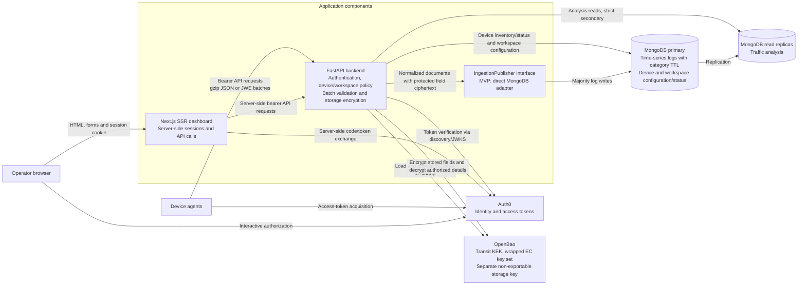

The publisher is the replaceable queue boundary; no broker or consumer is deployed
in the MVP. Analysis reads use read replicas in deployment, with an explicit
primary-read exception for single-member local development. Device configuration
and status operations use the primary in both environments.

### Development architecture

Compose runs only MongoDB and OpenBao. Python and the optional management frontend
are separate host processes with live development reload. A development agent may
use the loopback HTTP API; remote traffic requires HTTPS.

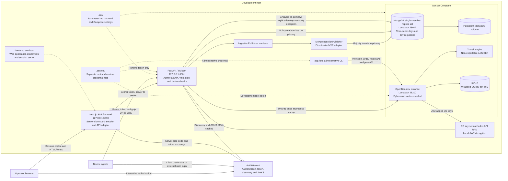

There is no broker or consumer process in the MVP. The replaceable publisher
receives normalized documents **after** upload decryption, validation, policy
checks and storage field encryption. Development OpenBao restart loses the KEK,
EC key set and storage key; existing MongoDB logs remain, but encrypted fields
become permanently unreadable. Production requires persistent key storage/backups.

### Deployment architecture

Solid dependency connections below describe the default external-dependency
profile. Dotted connections labeled as alternatives describe the bundled Helm
development profile; the API does not use both database providers simultaneously.
The frontend and TLS gateway must be deployed separately: the chart currently
packages the Python API and optional development dependencies, not the frontend,
ingress, certificates, or production dependency operations.

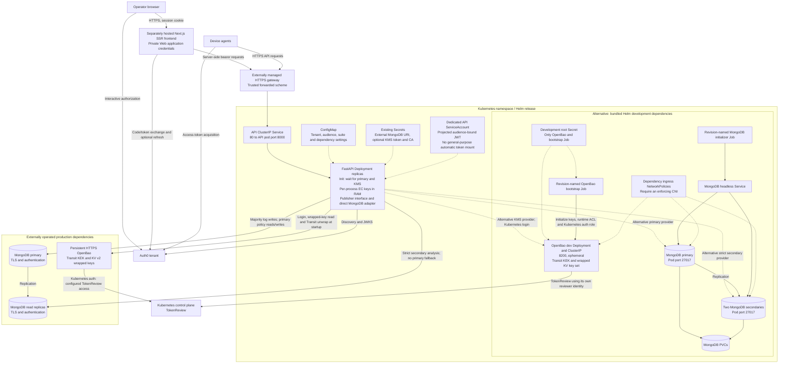

External OpenBao may use Kubernetes auth with operator-managed TokenReview access
or a mounted least-privilege runtime token. Bundled OpenBao uses its own
`system:auth-delegator` binding; API pods do not receive reviewer/admin privileges.
Default `replicaCount` is one, although the architecture supports multiple API
replicas. Every replica has its own startup-loaded EC key cache.

### Operation inventory

The sequences below share the authentication guard rather than repeating its
discovery/JWKS exchange on every API request. Resource keys use only device IDs.
Ordinary agents are restricted to their JWT-bound device; `manage:devices` permits
fleet-wide registration, policy changes and reads, but not agent impersonation
for status reports.

| Operation | Sequence |
| --- | --- |
| Interactive dashboard login, refresh and logout | [Dashboard authentication](#dashboard-authentication) |
| Machine-to-machine agent token acquisition | [Agent authentication](#agent-authentication) |
| HTTPS and bearer verification for `/api/v1/*` | [Shared API authentication guard](#shared-api-authentication-guard) |
| `GET /api/v1/me` | [Verified identity](#verified-identity) |
| `GET/PATCH /api/v1/workspace/configuration`, workspace form and `rotate-storage` | [Workspace storage configuration](#workspace-storage-configuration) |
| SSR overview, traffic, request details and workspace | [Server-rendered dashboard reads](#server-rendered-dashboard-reads) |
| `POST /api/v1/devices`, `GET /api/v1/devices`, `GET /api/v1/devices/{id}` and UI registration | [Device registration and inventory](#device-registration-and-inventory) |
| `GET /api/v1/devices/{id}/configuration` | [Device policy lookup](#device-policy-lookup) |
| `PATCH /api/v1/devices/{id}/configuration`, including UI form save | [Device policy change](#device-policy-change) |
| `PUT /api/v1/devices/{id}/configuration-status` | [Agent acknowledgement](#agent-acknowledgement) |
| `POST /api/v1/traffic-log-batches`, plaintext or JWE | [Batch ingestion](#batch-ingestion) |
| `GET /api/v1/traffic-logs` and `GET /api/v1/traffic-logs/{id}` | [Analysis reads](#analysis-reads) |
| API startup and graceful shutdown | [API process lifecycle](#api-process-lifecycle) |
| `GET /health`, `/openapi.json`, `/docs`, `/redoc` | [Health and API documentation](#health-and-api-documentation) |
| `prepare-dev`, `bootstrap-dev`, `initialize`, `bootstrap-kubernetes` | [KMS initialization and credentials](#kms-initialization-and-credentials) |
| `stage`, `activate`, `retire`, `rotate` | [EC key lifecycle](#ec-key-lifecycle) |
| `rotate-kek` | [Transit KEK rotation](#transit-kek-rotation) |
| `make dev`, `make dev-down` | [Development stack lifecycle](#development-stack-lifecycle) |
| Helm install, upgrade, smoke test and uninstall | [Deployment lifecycle](#deployment-lifecycle) |
| `make test-stack` and frontend browser tests | [Integration validation](#integration-validation) |

Schema validation and persistence-unavailable errors apply across resource
operations, even where their shared branches are omitted. There are no local
login/token, aggregation, or log/device deletion APIs.

#### Dashboard authentication

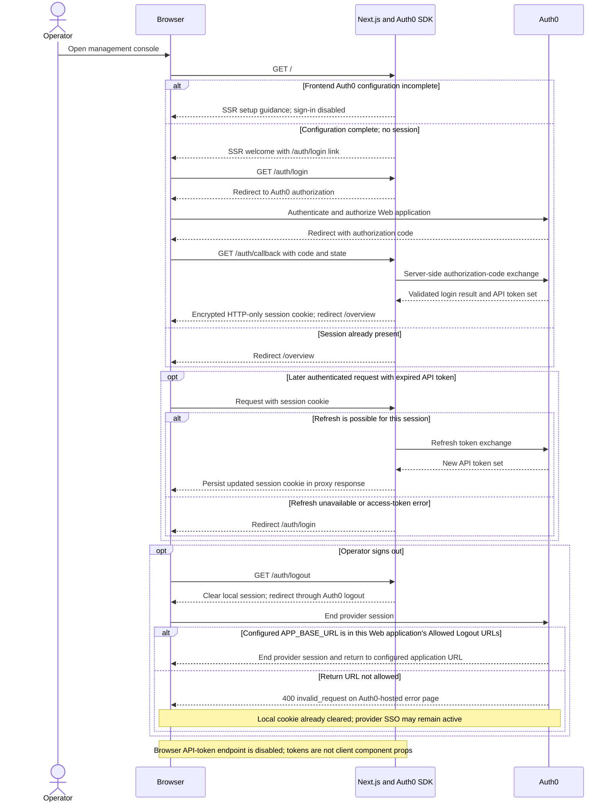

Refresh requires a refresh token/tenant configuration that permits it; otherwise
the SDK requires fresh authentication. Live interactive Auth0 login is not implied
by mocked-session browser tests.

#### Agent authentication

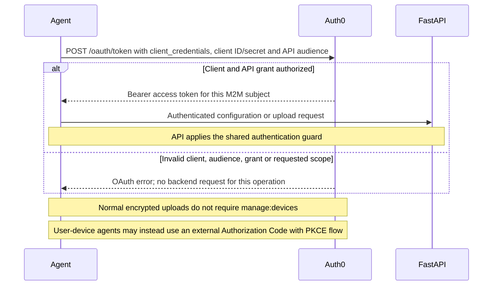

#### Shared API authentication guard

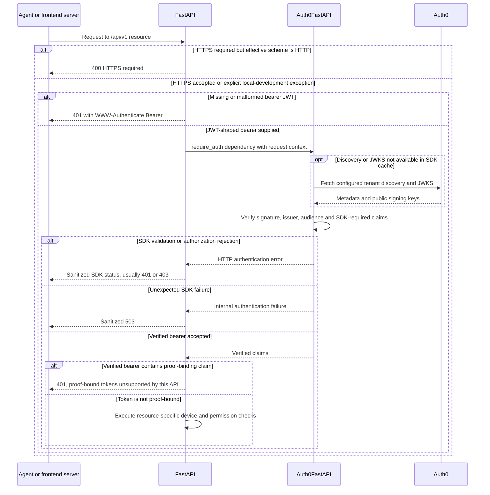

The SDK can classify discovery/JWKS fetch failures as token-verification failures;
not every upstream outage is guaranteed to become a 503. `/health` and API
documentation are outside this bearer guard.

#### Verified identity

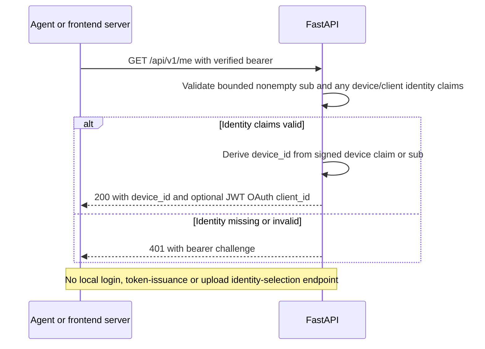

#### Server-rendered dashboard reads

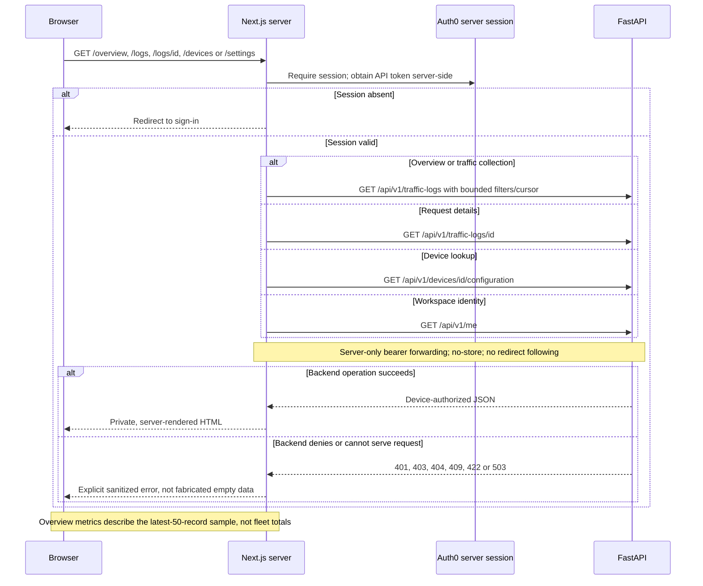

#### Workspace storage configuration

```mermaid
sequenceDiagram
    actor Operator
    participant UI as Next.js SSR and Server Action
    participant API as FastAPI
    participant Primary as MongoDB primary
    participant Transit as OpenBao dedicated storage key
    Operator->>UI: Open Workspace
    UI->>API: GET /api/v1/workspace/configuration with server-side bearer
    API->>API: Require manage:devices
    API->>Primary: Majority read of application-wide configuration
    Primary-->>API: Saved switches/version or all-enabled version 0 defaults
    API-->>UI: Three switches, version and update timestamp
    UI-->>Operator: Storage/encryption and retention forms with discard/plaintext/deletion warnings
    Operator->>UI: Change switches/windows and save
    UI->>API: PATCH encryption/retention policy and expected_version
    API->>API: Require manage:devices and strict Boolean schema
    opt Any category retained and encrypted
        API->>Transit: Validate non-exportable randomized AES-256-GCM key
    end
    API->>Primary: Atomic expected-version update with majority acknowledgement
    alt Stale version
        Primary-->>API: No match or concurrent first-write conflict
        API-->>UI: 409
        UI-->>Operator: Explicit conflict and current settings
    else Saved
        Primary-->>API: Incremented version and server update time
        API->>Primary: Reconcile partial TTL indexes and recheck latest settings version
        Note over API,Primary: DDL failure returns 503; desired settings may already be saved
        API-->>UI: 200 configuration
        UI-->>Operator: Field storage for future uploads; retention also affects existing logs
    end
    Note over API,Transit: KMS failures return sanitized 503, never plaintext fallback
    Note over Operator,Transit: Admin rotate-storage creates a new key version, preserving older decrypt versions
```

#### Device registration and inventory

```mermaid
sequenceDiagram
    actor Operator
    participant UI as Next.js SSR and Server Actions
    participant API as FastAPI
    participant Primary as MongoDB primary
    Operator->>UI: Enter JWT-bound device ID, name and initial policy
    UI->>UI: Require session and validate form fields
    UI->>API: POST /api/v1/devices with server-side bearer
    API->>API: Verify manage:devices, schema and encryption-key availability
    API->>Primary: Atomic insert with unique device ID and name indexes
    alt Device ID or name already exists
        Primary-->>API: Duplicate key
        API-->>UI: 400, no overwrite
        UI-->>Operator: Device already exists; use unique ID/name or edit existing policy
    else Registration persisted with majority acknowledgement
        Primary-->>API: Name, registration time and policy version 1
        API-->>UI: 201, Location and configuration/public key
        UI-->>Operator: Device registered; dedicated detail page and policy editor
    end
    UI->>API: GET /api/v1/devices with bounded limit/after
    API->>Primary: All accessible stored configuration records ordered by device ID
    Primary-->>API: Page plus lookahead
    API-->>UI: items and next_after
    UI-->>Operator: Stored device links, optional names and current policy
    Operator->>UI: Select device; navigate to /devices/id
    UI->>API: GET /api/v1/devices/id
    API->>Primary: Read stored policy, registration metadata and acknowledgement
    Primary-->>API: Device configuration or absent
    API-->>UI: Device details or 404 if absent
    UI-->>Operator: Identity, policy editor, acknowledgement, public suite and traffic link
    Note over Operator,Primary: No Auth0 credentials issued; registration does not prove connectivity
```

Policy/status-only records already reserve their device ID; registration rejects
them with 400 rather than overwriting or adopting them. Inventory includes stored
policy/status-only and version-zero records, with nullable name/registration time.
A default-only `/configuration` lookup does not persist a device or add it to
inventory. Missing item reads return 404; they never silently appear as defaults.
Registration is not an additional admission
check for legacy agents. The device-only schema starts with an explicitly reset
test database; there is no migration or automatic reset path.

#### Device policy lookup

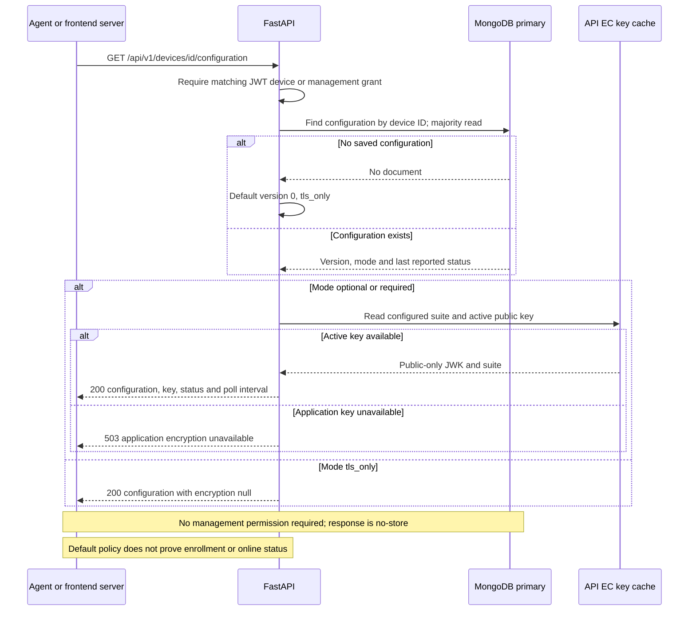

#### Device policy change

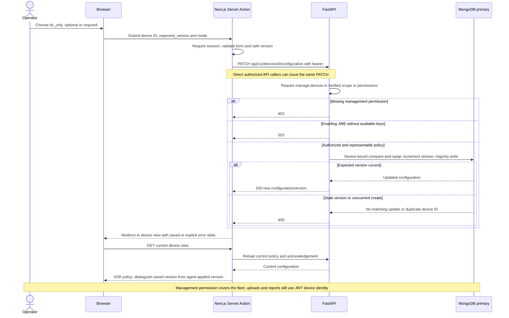

Invalid JSON/schema values return 422 before a write. Policy changes do not
retroactively cancel uploads whose acceptance checks have already completed.

#### Agent acknowledgement

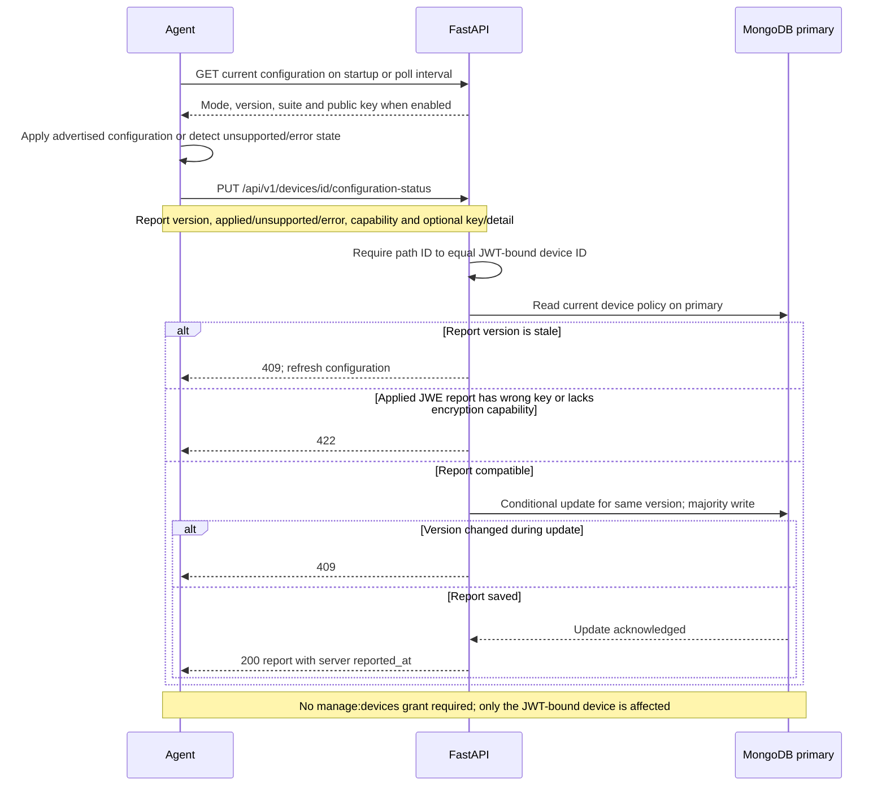

Agents must refresh public key/suite data even when the policy version is
unchanged: EC rotation and device-policy versioning are independent.

#### Batch ingestion

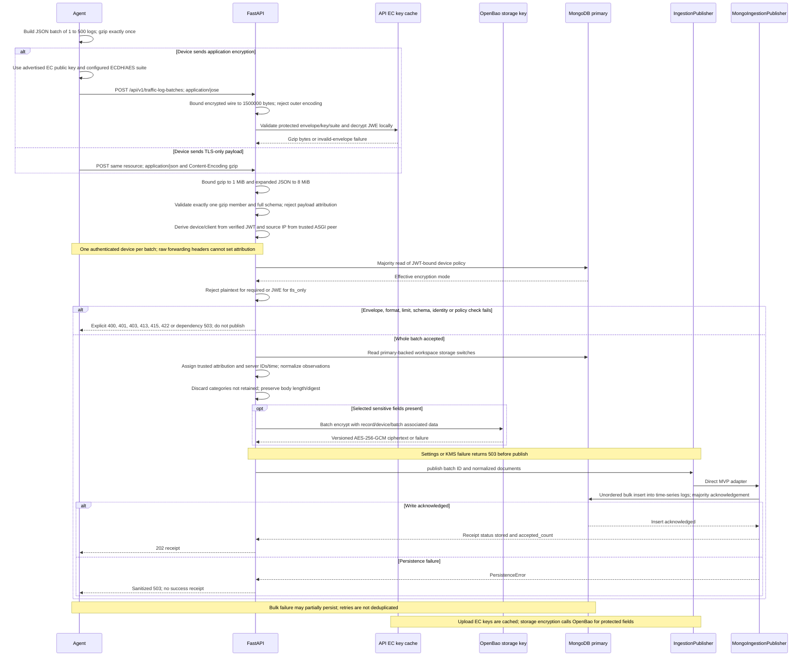

The flow groups failure outcomes for readability; an actual failed guard
short-circuits processing immediately. A future publisher may return `queued`
after durable queue acceptance, but no broker/consumer or exactly-once processing
is implemented.

#### Analysis reads

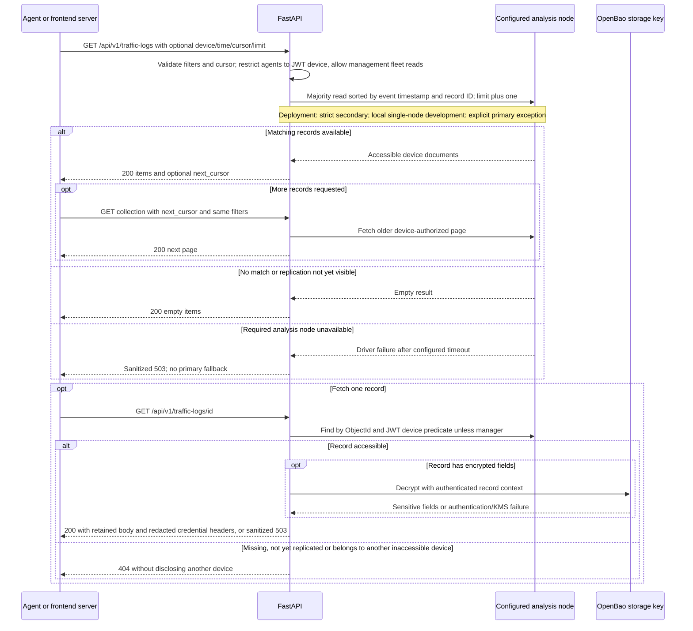

Invalid collection filters/cursors or record ID formats return 422 before the
corresponding database query. A just-accepted receipt does not guarantee immediate
secondary visibility.

#### API process lifecycle

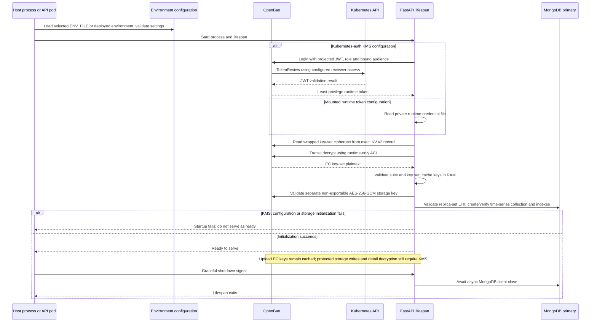

Kubernetes init containers additionally wait for primary reachability and
successful KMS key loading before launching the API container. The API process
still performs its own key load and storage initialization.

#### Health and API documentation

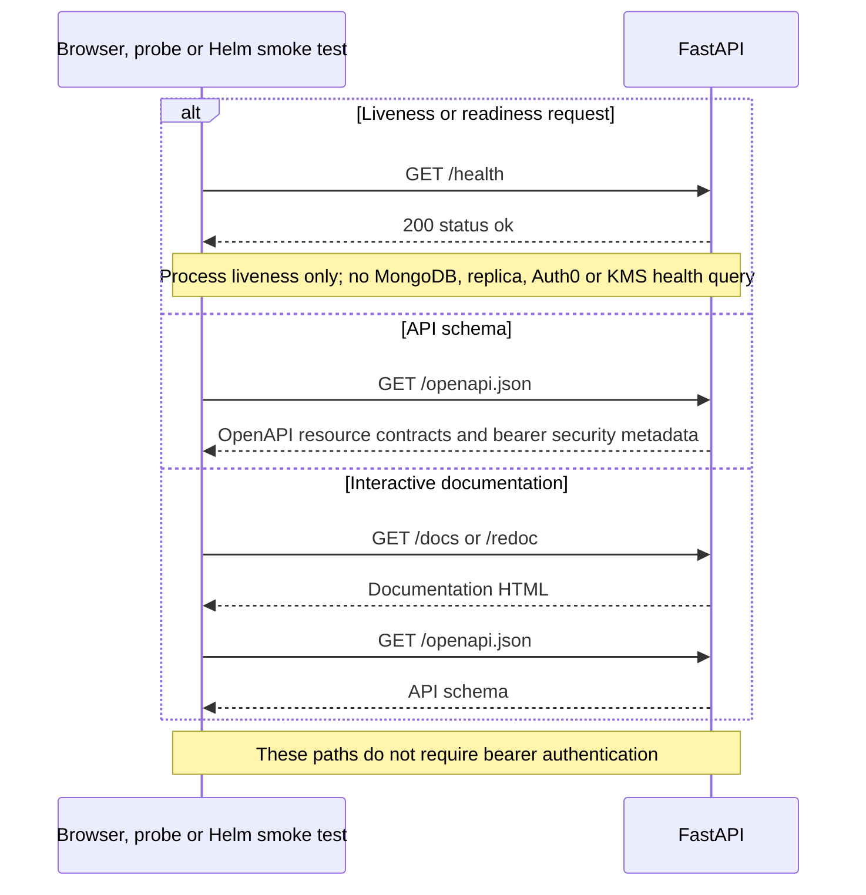

#### KMS initialization and credentials

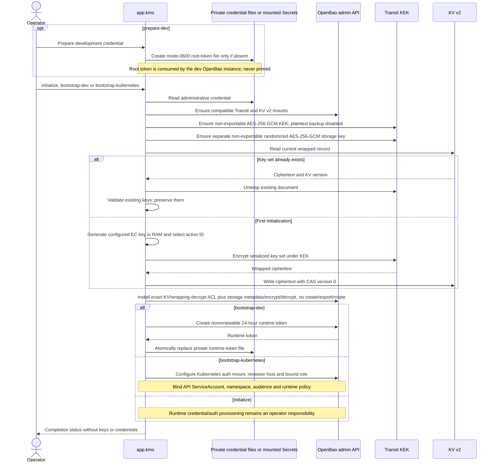

Incompatible mounts/KEKs, invalid keys or CAS failures stop the operation
explicitly. Production initialization/unseal, recovery, backups and audits remain
external operational responsibilities.

#### EC key lifecycle

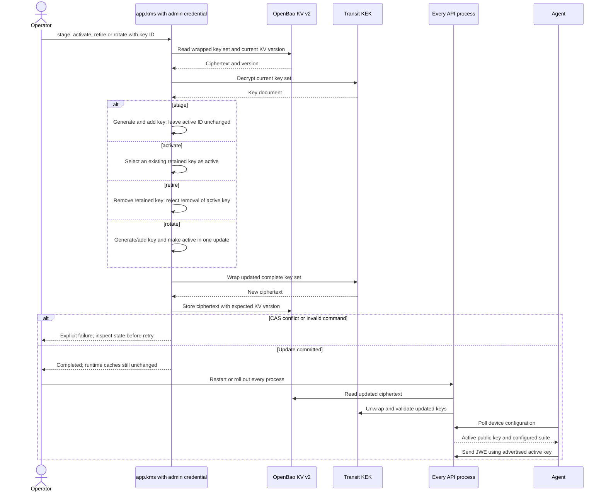

For multiple replicas, run **stage -> roll out all processes -> activate -> roll
out all processes**. This prevents a process advertising a key another process
cannot decrypt. One-step `rotate` is intended for a stopped/single-backend workflow.
Retain old EC keys for buffered uploads, then retire and restart all processes.
Retirement does not erase historical KV versions, backups, or old process memory.

#### Transit KEK rotation

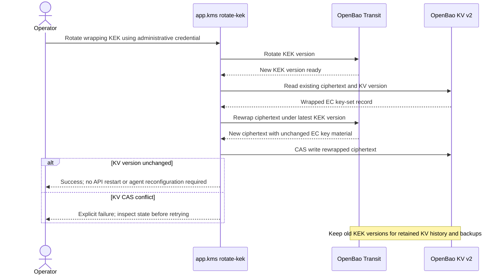

#### Development stack lifecycle

```mermaid
sequenceDiagram
    actor Developer
    participant Make
    participant Mongo as Compose MongoDB
    participant Bao as Compose OpenBao
    participant CLI as app.kms
    participant API as Host Python
    participant UI as Host Next.js
    Developer->>Make: make dev
    Make->>Mongo: Start and wait for health
    Mongo->>Mongo: Initiate one-member replica set only if uninitialized
    Make->>CLI: prepare-dev
    Make->>Bao: Start and wait for health
    Make->>CLI: bootstrap-dev
    CLI->>Bao: Provision/preserve key set and refresh runtime credential
    Make->>API: python -m app using selected ENV_FILE
    Note over API: Run startup sequence#59; reload backend source without image rebuild
    opt Management frontend
        Developer->>Make: make frontend-dev
        Make->>UI: Start Next.js using separate frontend/.env.local and port 3000
    end
    Developer->>API: Ctrl-C
    API->>API: Graceful lifespan shutdown and awaited MongoDB close
    Developer->>UI: Ctrl-C if frontend was started
    Developer->>Make: make dev-down
    Make->>Mongo: Remove Compose container#59; retain persistent volume
    Make->>Bao: Remove container#59; ephemeral KMS state is lost
    Note over CLI,API: After KMS restart, bootstrap again and restart API#59; old buffered JWE may be unrecoverable
```

`make run` starts only Python. `mongo-up/down` and `openbao-up/down` target the
individual dependencies. `make frontend-build` and `make frontend-start` build
and run the production SSR bundle independently of the Python image.

#### Deployment lifecycle

```mermaid
sequenceDiagram
    actor Operator
    participant Helm
    participant Kube as Kubernetes
    participant Jobs as Optional dependency initializer Jobs
    participant Dependencies as MongoDB and OpenBao
    participant API as API pod init containers and process
    Operator->>Helm: make helm-up with selected context, values and immutable image
    Helm->>Kube: Create or upgrade Service, Deployment, ConfigMap, ServiceAccount and mounts
    alt Bundled development dependencies enabled
        Helm->>Kube: MongoDB StatefulSet/PVCs, OpenBao dev Deployment, RBAC and NetworkPolicies
        Helm->>Jobs: Revision-named MongoDB and OpenBao bootstrap Jobs
        Jobs->>Dependencies: Initialize only absent state#59; preserve existing membership/keys
    else External dependency profile
        Note over Kube,Dependencies: Operator already provisioned authenticated MongoDB and persistent HTTPS OpenBao
    end
    Kube->>API: Start wait-for-primary init container
    API->>Dependencies: Wait for primary reachability
    Kube->>API: Start wait-for-openbao init container
    API->>Dependencies: Retry runtime authentication and key-set loading
    Kube->>API: Start application container
    API->>Dependencies: Perform API startup/key-load/storage initialization
    Kube->>API: Startup/readiness/liveness probes on /health
    Helm-->>Operator: Install or upgrade completes after workloads and Jobs are ready
    opt Deployment smoke test
        Operator->>Helm: make helm-test
        Helm->>Kube: Run smoke-test pod
        Kube->>API: Check Service /health and current OpenAPI routes
        Helm-->>Operator: Smoke-test result
    end
    opt Local access
        Operator->>Kube: make helm-port-forward
        Kube-->>Operator: Loopback 18000 to API Service
    end
    opt Uninstall
        Operator->>Helm: make helm-down
        Helm->>Kube: Remove release workloads, Services, Jobs and bundled dev root Secret
        Note over Kube,Dependencies: MongoDB PVCs retained#59; bundled OpenBao state lost#59; external services untouched
    end

```

ConfigMap checksum changes trigger a Deployment rollout; EC key changes require
an explicit rollout. A gateway, frontend deployment, certificates, external
dependency provisioning and production secret rotation are not installed by
this Helm chart.

#### Integration validation

```mermaid
sequenceDiagram
    actor Tester
    participant Test as make test-stack
    participant Plain as Plaintext device thread
    participant Encrypted as Encrypted device thread
    participant IdP as Real Auth0 tenant
    participant API as Running backend stack
    Tester->>Test: Load private profile with two clients and optional expected device IDs
    par Plain device
        Test->>Plain: Release synchronized start
        Plain->>IdP: Client-credentials token request
        IdP-->>Plain: Access token
        Plain->>API: Discover JWT-bound device via /me#59; read existing plaintext policy and acknowledge
        Plain->>API: Upload three synthetic logs as gzip JSON
        API-->>Plain: 202 stored or durable queued receipt
    and Encrypted device
        Test->>Encrypted: Release synchronized start
        Encrypted->>IdP: Client-credentials token request without management scope
        IdP-->>Encrypted: Agent access token
        Encrypted->>API: Discover JWT-bound device via /me#59; read existing JWE-compatible policy
        Encrypted->>API: Acknowledge advertised suite/key
        opt Existing policy is required
            Encrypted->>API: Attempt plaintext gzip
            API-->>Encrypted: 403 required-encryption enforcement
        end
        Encrypted->>API: Upload three synthetic logs as compact JWE
        API-->>Encrypted: 202 receipt
    end
    loop Bounded visibility wait for each device
        Plain->>API: Read own batch through paginated analysis API
        Encrypted->>API: Read own batch through paginated analysis API
    end
    Test->>Test: Verify counts, IDs, redaction, body minimization and distinct devices
    Test->>API: Query each other device and record IDs
    API-->>Test: 403 for explicit foreign device queries#59; 404 for foreign records
    Test-->>Tester: Pass or explicit failure#59; synthetic records remain
    Note over Test,Encrypted: No policy writes or management scope#59; incompatible setup fails explicitly
```

```mermaid
sequenceDiagram
    actor Developer
    participant Test as make frontend-test-browser
    participant Browser as Chromium
    participant UI as Production Next.js test server
    participant Mock as Loopback mock API
    Developer->>Test: Build SSR bundle and run Playwright
    Test->>Mock: Start loopback 38002 backend fixture
    Test->>UI: Start loopback 3301 with test-only configuration
    Test->>Browser: Supply session via public Auth0 generateSessionCookie test helper
    Browser->>UI: Render pages, including JavaScript-disabled requests
    UI->>Mock: Server-side bearer reads, registration POST and policy PATCH
    Mock-->>UI: Fixture data, duplicate 400, permission denials and version conflicts
    UI-->>Browser: SSR HTML and form outcomes
    Test->>Test: Assert token non-disclosure, mobile layout, disabled token endpoint and concurrency protection
    Test->>UI: Stop temporary frontend server
    Test->>Mock: Stop temporary backend fixture
    Test-->>Developer: Browser results
    Note over Test,Mock: No real OAuth exchange, MongoDB or OpenBao in this browser suite
```

The backend's opt-in database/KMS integration tests separately exercise real
time-series storage, replica command routing, policy CAS, envelope decryption and
OpenBao administrative/runtime boundaries. See the test inventory above and
the runbook for their environment selectors.
