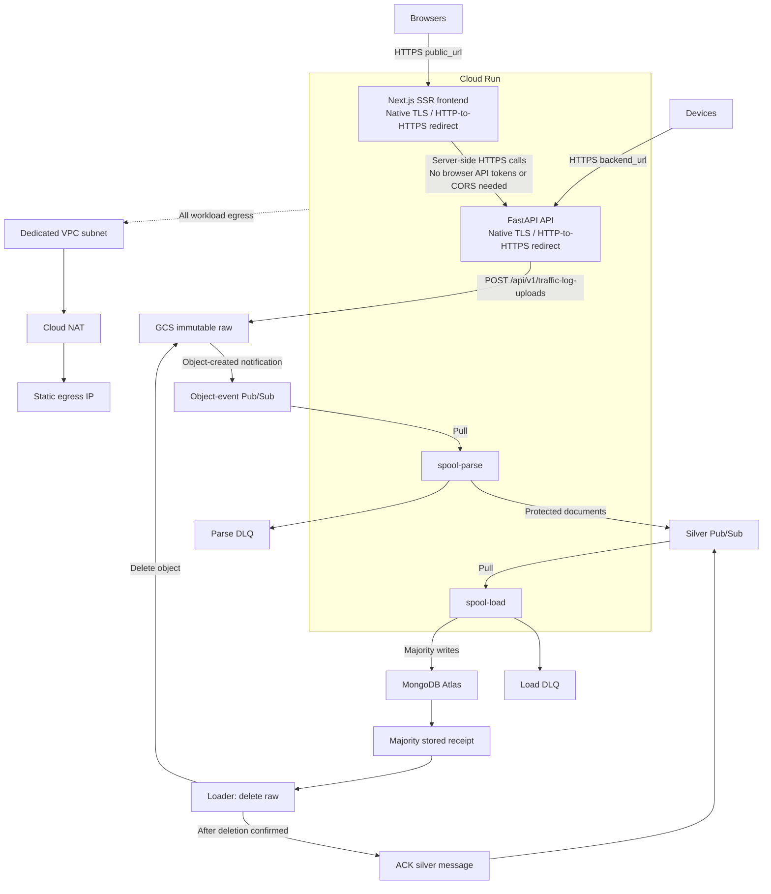

<!-- Purpose: Guide GCP deployment and operation, including Terraform provisioning, Cloud Run architecture, identity and secrets, encryption, and verification. -->

# GCP production deployment

Use a dedicated billing-enabled GCP project per environment. This is an independent
production deployment; local development supports full Compose containers or
native applications with Docker dependencies. Cloud-only KMS adapters remain
under `infra/gcp/`.

## Impact of local Compose profiles and native collector mode

**No Terraform or Cloud Run topology changes are required.** Compose profiles
select local processes/containers only; Terraform and the cloud deployment script
do not read `docker/docker-compose.yml`.

| Area | Impact / required adjustment |
| --- | --- |
| Cloud workloads | Still four separate services: backend, frontend, spool-parse and spool-load; no local proxy/MinIO/bridge/emulator is deployed |
| Images / commands | Unchanged cloud build paths: `infra/gcp/runtime/Dockerfile` for API/workers and `docker/frontend.Dockerfile` for frontend; cloud supervisor entrypoints remain unchanged |
| Native collector | Local `.venv/bin/python -m app` does not replace, stop or supervise any deployed Cloud Run instance |
| Networking | Local Compose DNS and loopback ports do not alter Cloud Run HTTPS origins, VPC/NAT, Atlas allowlists or workload identities |
| MongoDB | Local container direct connections require both `APP_ENV=development` and explicit primary reads; production continues rejecting direct connections and using strict-secondary analysis |
| Frontend | The additional `http://collector` exception requires explicit development; the deployed frontend retains the generated HTTPS `BACKEND_API_URL` |
| Cleanup / retention | No new cloud cleaner service/job is required: loader deletes raw after persistence; MongoDB TTL handles configured retention |
| Environment / secrets | Do not copy Compose development overrides, MinIO/OpenBao credentials, emulator addresses or direct Mongo URIs into cloud configuration; existing secret bootstrap and Terraform env generation already enforce separation |

The regular next image build includes the development-gated configuration
changes, but there is no profile migration or mandatory infrastructure rollout.
Keep cloud image paths/entrypoints, production read routing and generated URLs
unchanged. There is no billed-resource action associated with switching local
modes; the existing GCP check/deploy commands retain their behavior.

## Deployment summary

Frontend and API use separate generated Cloud Run HTTPS URLs; workers stay
internal. No load balancer, purchased domain or custom certificate is required.
Keep the existing Auth0 tenant and API audience.

Use the [automated deployment command](#automated-deployment) for the normal
workflow. The numbered procedure below remains the manual alternative and
documents the underlying permissions and resources.

1. Prepare a billing-enabled GCP project, Terraform, Google Cloud CLI, Docker,
   Python and authenticated deployment credentials.
2. Bootstrap Terraform state, configure `terraform.tfvars`, then apply foundation
   resources with `deploy_services = false` ([foundation setup](#1-tools-authentication-and-state)).
3. Provision MongoDB Atlas with healthy secondaries and allowlist Terraform's
   `egress_ip` ([Atlas and Auth0](#2-atlas-generated-urls-and-auth0)).
4. Run `make gcp-secrets-bootstrap` with the cloud venv, project and environment
   ([secret initialization](#3-populate-secret-manager)). It fills missing values
   and reports numeric secret versions to pin.
5. Read `terraform -chdir=infra/gcp output -raw public_url`. Register
   `<public_url>/auth/callback`, `<public_url>` as logout URL and web origin in
   Auth0. Keep the existing API audience and any required localhost entries.
6. [Build and push both images](#4-build-and-push-images), configure immutable image tags and
   secret versions, then set `deploy_services = true` and review/apply the plan
   ([service rollout](#5-deploy-services)).
7. Open `public_url`, configure agents with `backend_url`, and verify sign-in,
   the Status page and an ingestion round trip through Mongo storage/raw cleanup.

The sections below contain the commands and permission requirements. Atlas, NAT,
storage, messaging, KMS and running services still incur costs.

## Automated deployment

[`deploy.py`](deploy.py) orchestrates the existing Terraform configuration and
missing-only secret bootstrap using **gcloud, Docker and Terraform**. It reads
cloud status before changing anything, creates missing infrastructure, publishes
the cloud backend/frontend images, pins secret versions, deploys all four
services, and checks readiness, HTTP liveness and unauthenticated API rejection.
The API initializes its Mongo collections/indexes on startup; there is no separate
database reset or local OpenBao initialization in this workflow.

### One-time prerequisites

Install Terraform >=1.9, Google Cloud CLI, Docker with an active daemon and
Python >=3.11. A billing-enabled GCP project and the
[deployer permissions](#1-tools-authentication-and-state) are required.
Authenticate both the CLI and Application Default Credentials (ADC):

```bash
gcloud auth login
gcloud auth application-default login
gcloud auth application-default set-quota-project YOUR_PROJECT_ID
make gcp-install
```

ADC and the gcloud login are separate. The script never downloads service-account
keys or launches an interactive authorization flow on your behalf.
The deployer also needs `secretmanager.versions.get` to verify pinned-version
metadata, in addition to the standalone bootstrap's get/list/add permissions;
secret payload read access is not required by the script.
`make gcp-install` creates the ignored cloud Python environment; set
`GCP_VENV=/path/to/venv` to reuse a compatible environment.

Keep nonsecret settings in ignored `infra/gcp/terraform.tfvars`, starting from
the example if needed. The script reuses backend `.env` and frontend
`frontend/.env.local` (or `frontend/.env` when `.env.local` is absent), without
sourcing them as shell scripts. Terraform evaluates HCL, rather than a shell or
ad-hoc parser. Values are selected as follows:

| Setting | Source / behavior |
| --- | --- |
| Project | `--project`, tfvars, or `GCP_PROJECT_ID`; never local emulator `GOOGLE_CLOUD_PROJECT=logger-local` |
| Region / environment | Explicit CLI override, then tfvars, then Terraform defaults |
| Auth0 domain / audience / frontend client ID | tfvars, with env-file fallback; conflicting local identity settings fail rather than reusing the wrong secret |
| Frontend Auth0 client secret | Process environment or frontend/backend env files; secure prompt only when missing in Secret Manager and locally |
| Cloud Mongo URI | `GCP_MONGO_URI`, otherwise a TLS/replica-set-compatible `MONGO_URI`; secure prompt if only local Mongo settings are available |
| EC key set / cloud session secret | Generated in RAM only when absent; local OpenBao keys and frontend session secrets are not copied |
| Previously deployed image tags / secret pins | Preserved from the generated deployment settings until a new rollout; pinned secrets are never silently advanced to newer versions |

Process environment overrides env-file fallback values. Local MongoDB,
MinIO/emulator endpoints, OpenBao credentials and development primary-read
overrides are not deployed. Cloud Mongo must have healthy secondaries, verified
TLS, suitable permissions and a fresh database for cloud ciphertext. The script
does not provision Atlas clusters, migrate local ciphertext or change Auth0 grants.
Do not put credential values in `GCP_ARGS` or tfvars.

### Check and deploy

From the repository root:

```bash
make gcp-check                    # Read-only status and credential preflight
make gcp-deploy                   # Guided deployment; confirm plans and external setup
```

`GCP_ARGS` forwards CLI options. For example, override an accidentally configured
zone with a **region** (`europe-west2`, not `europe-west2-a`):

```bash
make gcp-check GCP_ARGS="--region=europe-west2"
make gcp-deploy GCP_ARGS="--region=europe-west2 --release=release-20261026-1"
```

If gcloud is installed but absent from this shell's PATH, add
`--gcloud=/absolute/path/to/google-cloud-sdk/bin/gcloud` to `GCP_ARGS`.
The script exposes that SDK directory to Docker's gcloud credential helper too.
Use `--env-file` / `--frontend-env-file` for alternative local configuration files.
Run `infra/gcp/.venv/bin/python -m infra.gcp.deploy --help` for all options.

The guided flow:

1. Verify CLI/ADC authentication and billing; report each application's Cloud Run
   service as absent, ready or not ready.
2. Create the private, versioned remote state bucket if absent and initialize the
   GCS backend at `logger/ENVIRONMENT`. The default bucket is
   `PROJECT_ID-logger-tfstate`; override it with `--state-bucket`.
3. Plan/apply foundation resources. **Existing managed services remain enabled**;
   reruns never apply a blanket `deploy_services=false` to an active deployment.
4. Print the NAT egress `/32` and generated Auth0 callback/logout/web-origin URLs.
   Confirm that Atlas and Auth0 have been configured before rollout. Existing
   Auth0 allowlist entries must be preserved.
5. Initialize missing secrets from safe local inputs or hidden prompts, verify
   enabled numeric pins, and build/push missing immutable image tags.
6. Plan/apply the application rollout and verify all four Ready conditions, backend
   `/health` returning `200`, frontend `/` returning `200`, and `/api/v1/me`
   returning `401` without a token. Complete authenticated sign-in/upload checks
   separately; these probes do not prove an end-to-end ingestion round trip.

To resume interrupted image publication, supply the **same `--release`**.
Already-published immutable tags are reused, not overwritten. Without a release
argument each invocation creates a unique tag. Do not reuse an old tag to deploy
changed source.

For unattended use, provision Atlas/Auth0 beforehand and explicitly acknowledge
those external prerequisites:

```bash
make gcp-deploy GCP_ARGS="--yes --external-ready --release=release-20261026-1"
```

`--yes` approves only nondestructive Terraform plans; deletion/replacement is
always refused. Without `--external-ready`, unattended deployment stops after
foundation and prints the required external settings. Credentials must already
exist locally or in Secret Manager to avoid secure input prompts.

### State, reruns and failure handling

The script writes **nonsecret** resolved settings, deployed tags and numeric
secret pins to ignored `infra/gcp/deployment.auto.tfvars.json` with private file
permissions. Keep this file to preserve release pins on reruns; normal Terraform
commands also load it. It takes precedence over `terraform.tfvars`, so review it
when deliberately changing pins/rolling back. Secret rotation remains a separate
reviewed operation. No secret payload enters this file, Terraform plans/state,
Docker build arguments or command output.

The state bucket is created/protected with gcloud, not the alternative
`bootstrap/` Terraform workspace. If already initialized manually, supply the
same bucket/prefix. The command refuses local state, a different initialized
backend, nondefault workspaces, destructive plans and Cloud Run services not
owned by the selected state. It does not import arbitrary existing cloud resources
or recover lost Terraform state automatically. Resolve those conditions using
the manual procedure before rerunning.

Failures stop with a nonzero exit code and a named failed step; tool diagnostics
that could contain credentials are withheld. Repair credentials/IAM or external
dependencies, then rerun. Published images, successful Terraform changes and
already-created secrets are retained; there is no rollback by deletion.
Only one operator should deploy/bootstrap a given environment at a time.

## Architecture

The implementation status provides the maintained
[production architecture diagram](../../docs/IMPLEMENTATION_STATUS.md#production-architecture),
[operation sequences](../../docs/IMPLEMENTATION_STATUS.md#operation-sequence-diagrams)
and [cloud bootstrap sequence](../../docs/IMPLEMENTATION_STATUS.md#cloud-secret-and-key-bootstrap).
The compact flow below is a deployment reference, not a replacement for those
reviewer-facing visual views.



Terraform always provisions the private regional raw bucket, GCS notifications,
object/silver topics and pull subscriptions, both DLQs with inspection subscriptions,
scoped IAM, backlog/DLQ alerts and **four workload identities**:
backend, frontend, spool-parse and spool-load. `deploy_services` gates all four
Cloud Run services, not raw storage/Pub/Sub provisioning.
Atlas clusters and credentials are provisioned independently.

The management sidebar's **Status** page uses the shared `/api/v1/status` API.
Terraform grants the backend read-only raw-bucket and two-subscription metadata
access, not message consumption. Workers report per-instance health through
MongoDB, so this requires no public worker endpoints or Cloud Run control-plane
access. Deploy updated workers and apply IAM changes together. Probe failures
and missing reports are visible as unavailable/unknown; this snapshot does not
replace Pub/Sub backlog/DLQ alerts. See the
[status runbook](../../docs/RUNBOOK.md#pipeline-status).

### Ingestion contract and recovery

The [pipeline design](../../docs/INGESTION.md) defines acknowledgement, policy,
buffering, retention and at-least-once guarantees. Use the
[recovery runbook](../../docs/RUNBOOK.md#retry-backpressure-and-recovery) for replay
and cleanup; native load DLQs may contain protected documents, not just pointers.

The parser has raw-read, object-subscription consume, silver/parse-DLQ publish,
Mongo and Cloud KMS/Secret Manager access. The loader has raw-delete,
silver-subscription consume, load-DLQ publish and Mongo, without EC/KMS access.
Replay operators separately need raw-read, receipt-update and event-publish access.

`terraform output spool_environment` exposes nonsecret runtime settings.
Runtime uses ADC/workload identity, never downloaded service-account keys.
Production environment settings select GCS through Terraform/Helm; local
`.env.example` uses MinIO/emulator defaults. Do not carry local endpoint/emulator
overrides into production.
`spool_mongo_documents_per_second` is per loader instance; total capacity multiplies
by `worker_instances`. Worker supervision lives in `runtime/spool.py`.
Configure `notification_channels`; backlog defaults warn above 500 messages or
3600 seconds, below message retention. Monitor both DLQs and raw cleanup.

### Cloud-only encryption adapter

The cloud backend Dockerfile overlays `runtime/openbao.py` onto the KMS interface:

- Workload identity/ADC replaces OpenBao tokens.
- A pinned Secret Manager EC key-set version is loaded into RAM; no private key
  files, build arguments or Terraform secret values.
- Each protected record uses a random AES-256-GCM data key and 96-bit nonce;
  Cloud KMS wraps the key with authenticated record/device/batch context.
  Native async KMS is bounded to 16 concurrent operations per process;
  CPU preparation uses `asyncio.to_thread`. KMS failures fail closed.
- Stored data keys are encrypted; wrapping keys remain non-exportable in KMS.
  CRC32C is verified on Secret Manager/KMS responses.
- The document schema and `vault:v1:` prefix are retained, but the payload is
  `gcp-kms-envelope-v1`, **not OpenBao ciphertext**. Local/cloud ciphertext are
  not interchangeable. Use a fresh cloud database; cross-key-authority conversion
  is not performed. Retain keys needed by Mongo backups and all raw backlog.

The frontend is **Next.js SSR**, not a static SPA. Keep Auth0 client/session
secrets and API tokens server-side, never `NEXT_PUBLIC_*`.
The two services use distinct generated `run.app` origins, with no load balancer,
custom DNS, managed-certificate resources or Cloud Armor policy. API paths are
preserved, not stripped. `/api/v1/*`, `/docs`, `/redoc`, `/openapi.json` and
`/health` are on the **backend** URL, not the frontend URL.

## 1. Tools, authentication and state

Install Terraform >=1.9, Google Cloud CLI, Docker with Linux amd64 build support,
Python >=3.11. Provisioning identities need service enablement,
IAM/custom roles, service accounts, Secret Manager/KMS, registry, networking,
logging/monitoring and private state-bucket administration.
Do not grant administrative roles to runtime identities.

```bash
export PROJECT_ID="your-gcp-project"
export REGION="europe-west1"
export ENVIRONMENT="production"
export STATE_BUCKET="${PROJECT_ID}-logger-tfstate"
gcloud auth login
gcloud config set project "$PROJECT_ID"
gcloud auth application-default login
gcloud auth application-default set-quota-project "$PROJECT_ID"
gcloud services enable serviceusage.googleapis.com cloudresourcemanager.googleapis.com \
  storage.googleapis.com --project="$PROJECT_ID"
```

CI uses Workload Identity Federation and a narrow deployer identity; do not
download JSON keys. `gcloud` credentials and Terraform ADC are distinct.
From the repository root:

```bash
terraform -chdir=infra/gcp/bootstrap init
terraform -chdir=infra/gcp/bootstrap plan \
  -var="project_id=$PROJECT_ID" -var="region=$REGION" \
  -var="state_bucket_name=$STATE_BUCKET" -out=bootstrap.tfplan
terraform -chdir=infra/gcp/bootstrap apply bootstrap.tfplan
cp infra/gcp/bootstrap/backend.tf.example infra/gcp/bootstrap/backend.tf
terraform -chdir=infra/gcp/bootstrap init -migrate-state \
  -backend-config="bucket=$STATE_BUCKET" -backend-config="prefix=bootstrap"

cp infra/gcp/terraform.tfvars.example infra/gcp/terraform.tfvars
# Set project, region, environment and Auth0. Keep deploy_services=false.
terraform -chdir=infra/gcp init \
  -backend-config="bucket=$STATE_BUCKET" -backend-config="prefix=logger/$ENVIRONMENT"
terraform -chdir=infra/gcp fmt -check -recursive
terraform -chdir=infra/gcp validate
terraform -chdir=infra/gcp plan -out=foundation.tfplan
terraform -chdir=infra/gcp apply foundation.tfplan
```

Keep a protected bootstrap-state backup until migration succeeds. Never operate
both local and remote states on the same bucket. Limit state access to deployment
operators/CI; state locking/version history does not make it public-safe.
Commit provider lock files, not `.terraform/`, state, plans, tfvars or secret values.
Use separate projects/backend prefixes/secret sets per environment.

## 2. Atlas, generated URLs and Auth0

### Choosing tfvars Auth0 settings

These settings are independent:

| Variable | What to supply |
| --- | --- |
| `auth0_domain` | Your existing Auth0 tenant or configured Auth0 custom hostname, without scheme/path; not the application's hostname. |
| `auth0_audience` | The **exact API Identifier** from Auth0 Dashboard > APIs, shared by frontend, backend and agents. It is not a routing URL and does not need to resolve. |
| `auth0_client_id` | The existing frontend Regular Web Application client ID, not an agent M2M client ID. |

Moving to GCP does not require changing the audience. Even an existing identifier
that looks like an old ngrok URL can stay unchanged without running ngrok.
Do not replace it with a generated Cloud Run URL or the new public hostname:
tokens must still match the API registered in Auth0.

There is **no application `domain` variable**. Terraform derives Cloud Run's
documented deterministic URLs from the service name, GCP **project number**
(not project ID) and region:
`https://SERVICE_NAME-PROJECT_NUMBER.REGION.run.app`.
Service names here stay within the platform's 63-character DNS-segment limit.
The URLs are available after the foundation apply, before containers exist,
so Auth0 callbacks can be configured without a deployment/self-URL cycle.

Keep credentials out of tfvars. The existing frontend client secret must be
uploaded to Secret Manager as described below. Register the new public callback,
logout and web-origin URLs on that same Auth0 application; retain localhost URLs
if the application is also used for local development.

```bash
terraform -chdir=infra/gcp output public_url
terraform -chdir=infra/gcp output backend_url
terraform -chdir=infra/gcp output egress_ip
terraform -chdir=infra/gcp output -json secret_names
```

Provision a MongoDB Atlas >=7.0 dedicated replica set near the selected GCP region,
with healthy secondaries, backups/PITR and a database-scoped `readWrite` user
including startup collection/index privileges. Allowlist only NAT egress `/32`,
not `0.0.0.0/0`. Private connectivity requires independently configured
peering/Private Service Connect.

Use a TLS-verified URI with the actual `replicaSet`, `retryWrites=true`,
`w=majority`, bounded `maxPoolSize` and `waitQueueTimeoutMS`. Encode credentials
correctly and verify SRV/TXT resolution from Cloud Run. Do not enable direct
connections or insecure certificate/hostname overrides. Production analysis
requires secondaries; primary fallback stays disabled. Firestore/Cloud SQL
cannot replace this Mongo schema/TTL/driver contract.

No DNS records, purchased domain or certificate provisioning are required.
`public_url` is the browser/frontend origin; `backend_url` is the API/agent origin.
Changing the region/environment/project changes these URLs and requires updating
Auth0 and agent configuration. Revisions keep the same service URLs.

When migrating an already-applied older configuration, remove `domain` from
your ignored tfvars and review the plan: it should remove the former edge
module/global ingress IP, not databases, raw objects, KMS keys or secrets.
Keep the separate **NAT egress IP**; Atlas still uses it. Switching origins also
means signing in again because browser sessions are hostname-scoped.

Use an existing Auth0 RS256 API with exact `auth0_audience`. Grant the frontend
Regular Web Application delegated API access and intended operator permissions.
For example:

| Setting | Value |
| --- | --- |
| Callback | `<public_url>/auth/callback` |
| Logout | `<public_url>` |
| Web origin | `<public_url>` |

Substitute the exact HTTPS `public_url` output, without angle brackets.
Keep the localhost entries too if reusing the same application for development.
Agents use separate M2M applications/grants,
never the frontend secret. Audience is an identifier and may end in `/api`;
`BACKEND_API_URL` is the backend HTTPS origin without `/api`. Terraform wires
frontend `APP_BASE_URL` to `public_url` and `BACKEND_API_URL` to `backend_url`.
SSR makes authenticated server-side API calls, so browser CORS access to the
backend is not needed. Terraform does not modify the Auth0 tenant.

## 3. Populate Secret Manager

Foundation creates empty secret containers, not versions. The administrative
bootstrap fills **only empty containers**, like local OpenBao initialization.
Run from the repository root, using ADC and the cloud dependencies:

```bash
python3 -m venv infra/gcp/.venv
infra/gcp/.venv/bin/pip install -r requirements.txt -r infra/gcp/runtime/requirements.txt
make gcp-secrets-bootstrap VENV=infra/gcp/.venv \
  PROJECT_ID="$PROJECT_ID" ENVIRONMENT="$ENVIRONMENT"
```

The command securely prompts for the **cloud Mongo URI** and existing frontend
Auth0 client secret only when missing. It generates a P-384 EC keyset and a
32-byte random session secret in memory only when those values are missing.
It never reads local `.env`/OpenBao credentials, exports existing secret values,
or modifies tfvars. Existing enabled versions are preserved, so rerunning after
partial failure initializes only the remaining values. A missing Terraform
container or disabled/destroyed newest version fails explicitly, not by replacing
keys or silently selecting an older version.

Progress includes resource/version names only. Standard output is a
`secret_versions = { ... }` block: review and copy its numeric versions into
`infra/gcp/terraform.tfvars`, never use `latest`. It reports the newest existing
enabled versions; do not change deliberately pinned older versions without
reviewing the intended deployment. Secret rotation remains an explicit operation
and needs a new Cloud Run revision. Retain historical EC keys while devices/raw
uploads depend on them.

For noninteractive use, supply private UTF-8 files instead of hidden prompts:

```bash
infra/gcp/.venv/bin/python -m infra.gcp.bootstrap_secrets \
  --project="$PROJECT_ID" --environment="$ENVIRONMENT" \
  --mongo-uri-file=/secure/path/mongo-uri \
  --auth0-client-secret-file=/secure/path/auth0-client-secret
```

Input files must have no group/other permissions (`chmod 600`); provision them
outside the repository. Do not put secret values in command arguments, shell
history, Terraform, build arguments or logs. Prompts refuse stdin that cannot
hide input. The bootstrap creates no private-key files.

The operator needs `secretmanager.secrets.get`, `secretmanager.versions.list`
and `secretmanager.versions.add` on the four Terraform-created secrets, plus
authenticated ADC. No secret payload read permission is needed. Do not grant
these administrative permissions to runtime identities. Run one bootstrap at a
time: Secret Manager version creation has no atomic create-if-empty operation,
so parallel initializations are not supported.

`runtime/provision_keyset.py` remains an explicit new-key provisioning tool; it
generates a fresh key on every invocation and is **not** the rerunnable bootstrap.
Terraform provisions the Cloud KMS wrapping key independently.

Frontend reads only its two secret values; loader reads Mongo only. Backend/parser
also receive EC-secret and key-scoped KMS permissions. Runtime identities cannot
change IAM, create secrets or rotate keys. The Cloud Run platform service agent
pulls same-project registry images; workloads need no registry administrator role.

## 4. Build and push images

Registry tags are immutable; choose unique release tags:

```bash
export RELEASE="release-1"
export BACKEND_REPO="${REGION}-docker.pkg.dev/${PROJECT_ID}/logger-${ENVIRONMENT}-backend"
export FRONTEND_REPO="${REGION}-docker.pkg.dev/${PROJECT_ID}/logger-${ENVIRONMENT}-frontend"
gcloud auth configure-docker "${REGION}-docker.pkg.dev"
docker build --platform linux/amd64 -f infra/gcp/runtime/Dockerfile \
  -t "${BACKEND_REPO}/api:${RELEASE}" .
docker push "${BACKEND_REPO}/api:${RELEASE}"
docker build --platform linux/amd64 -f docker/frontend.Dockerfile \
  -t "${FRONTEND_REPO}/dashboard:${RELEASE}" .
docker push "${FRONTEND_REPO}/dashboard:${RELEASE}"
```

API/parser/loader share the cloud image with role-specific commands. The ordinary
local image expects OpenBao and has no cloud entrypoints. No development
credentials, OpenBao server or service-account keys belong in either image.

## 5. Deploy services

Set `deploy_services=true`, both immutable image tags and pinned secret versions:

```bash
terraform -chdir=infra/gcp plan -out=production.tfplan
terraform -chdir=infra/gcp apply production.tfplan
```

Review IAM, ingress and always-on worker resources. Workers use instance-based
CPU (`cpu_idle=false`) and equal nonzero min/max counts. They have private
liveness HTTP, no public invoker, and are not request-driven Jobs or scale-to-zero
consumers. Supervision fails liveness when consumer tasks fail.

API/frontend have `INGRESS_TRAFFIC_ALL` and `allUsers` invoker access so browsers
and agents can use their generated URLs without Google IAM tokens.
**This does not bypass Auth0**: protected API routes still validate access tokens
and permissions. Workers remain internal with no public invoker. If organization
policy forbids public Cloud Run invocation, this topology needs an approved
alternative; do not disable Auth0 checks.

Cloud Run terminates TLS and supplies forwarding headers. The cloud-only API
entrypoint requires HTTPS metadata and takes the final platform-appended
`X-Forwarded-For` address, never the caller-supplied prefix, `Forwarded` or old
custom edge headers. Malformed/missing API transport metadata fails closed;
platform liveness probes do not require it. Uvicorn forwarding-header handling
remains disabled. Do not run this cloud entrypoint behind arbitrary additional
proxies or outside Cloud Run without revisiting this trust boundary.
The API wrapper and frontend supply HSTS directly now that no edge adds it.

```bash
export FRONTEND_URL="$(terraform -chdir=infra/gcp output -raw public_url)"
export BACKEND_URL="$(terraform -chdir=infra/gcp output -raw backend_url)"
curl --fail --show-error "$BACKEND_URL/health"
curl --head "$FRONTEND_URL/"              # frontend
curl --silent --output /dev/null --write-out '%{http_code}\n' \
  "$BACKEND_URL/api/v1/me"                 # 401 without Auth0 credentials
```

Verify docs, sign-in/callback, workspace reads, two-device gzip/JWE uploads,
asynchronous failures, `stored`/`raw_deleted`, protected detail reads and
cross-device denial. Use a separate ignored cloud stack-test profile; do not
rewrite local credentials. Set that profile's `STACK_TEST_BASE_URL` to
`backend_url` (not `public_url`) and use its separate M2M grants. Startup failures
in Mongo indexes or role-specific KMS/EC configuration are deployment failures,
not checks to bypass.

## Operations, costs and validation

- This is a single-region deployment, not regional failover. Test restore.
- Warm web instances, continuously billed workers, NAT/static IPs,
  GCS/Pub/Sub, KMS and Atlas cost money even at low traffic; configure budgets.
- Set Monitoring notification channels. Health checks are liveness, not end-to-end
  persistence. Monitor both subscription backlog depths/ages and DLQs, raw
  cleanup, worker errors, Mongo replication/pools, API 5xx and KMS quotas/latency.
- No Cloud Armor/WAF or edge rate limiting is provisioned. Keep bounded upload
  sizes, worker rates and instance limits; assess abuse protection before
  exposing production workloads. Frontend and sensitive API responses stay uncached.
- OAuth transaction URL logs are excluded from the default sink; apply matching
  exclusions to organization/custom sinks. Never log raw tokens/cookies/bodies.
- Bound worker rates, instance counts and Mongo pools together. Each protected
  record requires KMS wrapping; measure cost/quotas rather than assume speedup.
- KMS rotation retains old versions. Preserve all required EC/storage keys and
  Mongo backups; database backups without keys are unusable.
- Roll back using previous immutable images and still-valid pinned secrets.
  Do not destroy databases/keys. Decommissioning requires reviewed deletion-
  protection/`prevent_destroy` changes.

No-credentials validation:

```bash
terraform -chdir=infra/gcp init -backend=false
terraform -chdir=infra/gcp fmt -check -recursive
terraform -chdir=infra/gcp validate
terraform -chdir=infra/gcp test
infra/gcp/.venv/bin/python -m pytest -q infra/gcp/tests/runtime_checks.py infra/gcp/tests/bootstrap_checks.py infra/gcp/tests/deploy_checks.py
infra/gcp/.venv/bin/ruff check infra/gcp/deploy.py infra/gcp/bootstrap_secrets.py infra/gcp/runtime infra/gcp/tests
infra/gcp/.venv/bin/ruff format --check infra/gcp/deploy.py infra/gcp/bootstrap_secrets.py infra/gcp/runtime infra/gcp/tests
```

Mock Terraform/Google RPC tests do not prove live IAM, GCS event latency,
Atlas connectivity, platform forwarding headers or Auth0 grants. Complete staging smoke tests.
Deployment tests cover first/repeated rollout, read-only status, state/destructive
plan refusal, immutable image reuse and safe local secret input/pin preservation.
The cloud `*_checks.py` suites stay outside local test discovery; storage/Pub/Sub SDKs are
root dependencies, while KMS/Secret Manager SDKs stay in cloud requirements.

References: [Cloud Run contract](https://cloud.google.com/run/docs/container-contract),
[Cloud Run HTTPS URLs](https://cloud.google.com/run/docs/triggering/https-request#service_url),
[Secret Manager integration](https://cloud.google.com/run/docs/configuring/services/secrets).
