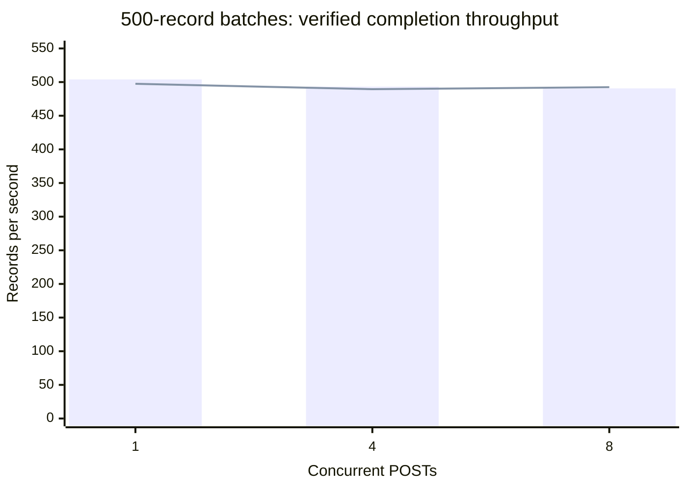
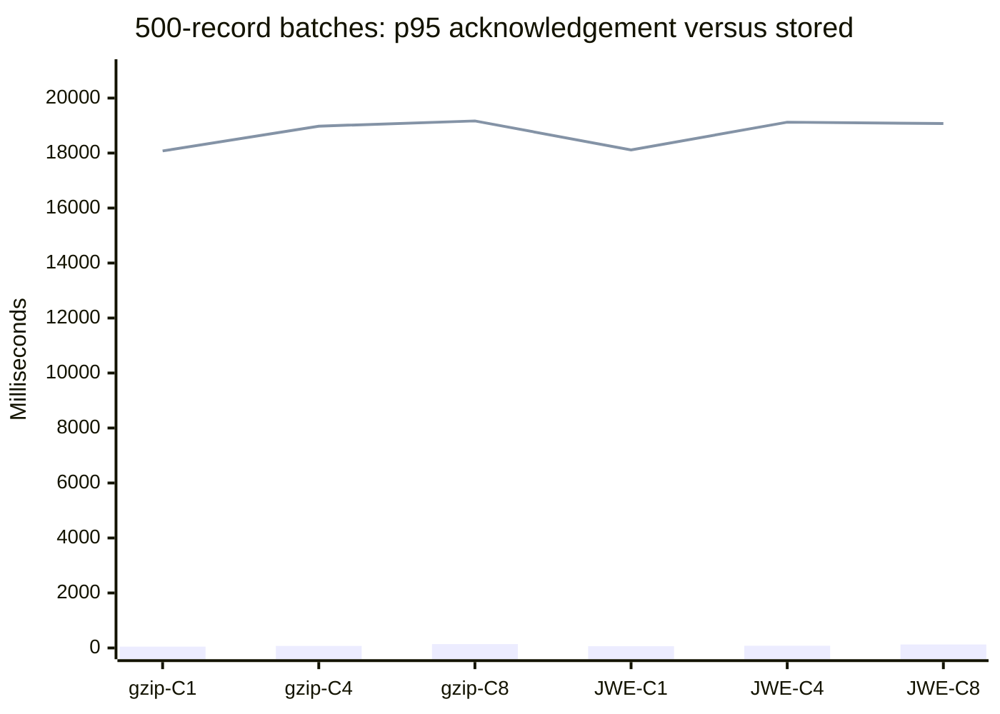
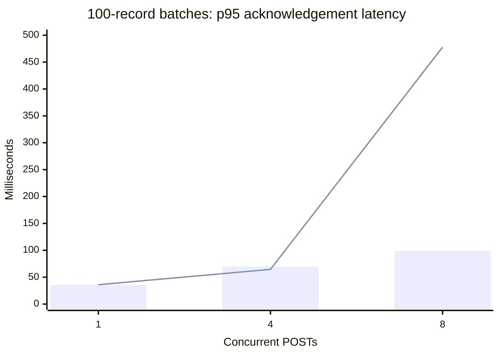

<!-- Purpose: Record the local engineering verification, ingestion benchmarks, fixes and measurement limitations. -->

# Engineering verification and performance report

**Measured:** 2026-10-26, 11:29:48-11:32:31 UTC (final benchmark run).
**Scope:** this working checkout, local services only; no production load test or
deployment. Results include uncommitted changes, not an immutable release.

All **18 final benchmark cases passed**: **360 uploads / 72,120 records** were
verified in MongoDB, with matching stored receipts and raw-object deletion.
Maximum-size batches sustained **489.42-503.97 records/sec** with one loader
configured for 500 documents/sec. A real maximum-batch encryption failure was
reproduced and fixed before collecting the final results below.

## Documentation and verification

Repository-authored documentation was read before testing, including the blueprint,
API/ingestion/encryption contracts, implementation diagrams, runbook, frontend,
deployment guides and original assignment. The manually maintained README roadmap
was preserved and was not used to generate tasks.

| Verification | Result |
| --- | --- |
| Final Python unit/service suite, including GCP runtime/bootstrap/deployment checks | **492 passed**, 2 environment-gated skips, 145.01 sec |
| Strict-secondary Mongo routing on an isolated three-member replica set | **1 passed**, 1.69 sec; covers the first skipped test |
| Real isolated NGINX routing, upload bytes and forwarding headers | **1 passed**, 2.11 sec; covers the second skipped test |
| Local HTTP-only two-device OAuth/ingestion integration after runtime fix | **1 passed**, 12.75 sec |
| Isolated benchmark-stack OAuth/ingestion smoke | Passed before the matrix |
| Frontend unit / mocked-backend browser / real-FastAPI-and-Mongo browser tests | **13 / 17 / 4 passed**, respectively |
| Frontend production build, lint and formatting checks | Passed |
| Python lint and changed-file formatting checks | Passed |
| Terraform backend-disabled validation and mocked tests in a temporary copy | Passed; **4 mocked tests** |
| Terraform formatting, Helm lint and all-profile Compose configuration | Passed |
| Kubernetes installed-release/health-hook verification | **Unavailable:** configured minikube API at `127.0.0.1:57149` refused connections |

The final Python results above represent **495 distinct passing tests** across
the broad suite and three separately executed cases. Frontend and Terraform
checks were completed earlier in the workflow; neither subsystem was changed
by the subsequent runtime fix.

### Failures found and changes made

1. **OpenBao maximum-batch failure:** a single 500-record upload remained
   `received` with `parse_dependency_unavailable`. The OpenBao container remained
   healthy and was not OOM-killed. A fixed-synthetic-input reproduction confirmed
   HTTP 400: `refused JSON input due to high complexity: exceeded maximum number
   of strings`. Field encryption now sends at most **100 bundles per Transit
   request**, validates every chunk, and attaches ciphertexts only after all
   chunks succeed. Two new regressions failed before the fix and pass afterward;
   real OpenBao integration also encrypts a full 500-record batch and decrypts
   records across chunk boundaries. Large individual-body coverage remains.
2. **Benchmark measurement errors:** polling previously began only after all
   uploads completed, and a shared semaphore could starve queued observations.
   Uploads are now observed independently, using separate bounded POST/poll
   pools and releasing polling slots between attempts. A stalled status request
   cannot overrun its completion deadline. ACK throughput ends at the last ACK,
   not the end of polling. Missing-host/path-prefixed origins and non-finite
   timeouts are rejected. Ten added regression cases cover these boundaries.
3. **Integration-harness isolation/routing:** MinIO tests now own separate object
   subscriptions and silver/dead-letter resources, clean them up, and wait for
   completion instead of assuming one pull contains work. The source bucket
   and notification topic remain shared: keep normal workers idle during this
   service test. Mongo routing assertions now distinguish intentional primary
   replay checks from strict-secondary analysis reads.

The only application-runtime modification is bounded OpenBao field-encryption
batching. HTTP contracts, acceptance-time policies, authenticated encryption
context, loader capacity and persistence semantics are unchanged. See the updated
[encryption contract](docs/ENCRYPTION.md#storage-algorithm-and-key-lifecycle) and
[parser sequence](docs/IMPLEMENTATION_STATUS.md#parsing-and-protection).

## Environment and workload

| Component | Configuration |
| --- | --- |
| Host | Linux/WSL2 `6.18.33.2-microsoft-standard-WSL2`; 16 logical CPUs; approximately 15,633 MiB RAM; Docker Desktop |
| Python / key libraries | Python 3.14.6; FastAPI 0.162.0; PyMongo 4.19.0; HTTPX2 2.16.0; joserfc 1.7.7; google-cloud-pubsub 2.43.0 |
| Frontend / infrastructure tools | Node 26.4.0; npm 11.17.0; Terraform 1.17.0; Helm 4.2.2 |
| HTTP target | **Direct loopback** `http://localhost:39090`; no TLS or reverse proxy in the final matrix |
| Application processes | One host API, one parser, one loader; reload disabled |
| Persistence / key authority | Existing local single-member Mongo replica set, unique temporary database; existing OpenBao, without key resets |
| Isolated transport | Fresh MinIO, Pub/Sub emulator and notification bridge on a dedicated temporary network |
| Transport memory limits | MinIO 512 MiB; Pub/Sub emulator 512 MiB; notification bridge 256 MiB |
| Loader | 500 documents/sec; one-batch initial burst allowed |
| Payload formats | gzip JSON; compact JWE over gzip using ECDH-ES+A256KW / A256GCM / P-384 |
| Batch sizes / concurrency | 1, 100, 500 records; POST concurrency 1, 4, 8 |
| Per-cell sample | 20 distinct uploads; no retry key; exact wire reused within a format/batch-size group |
| Synthetic record | 1,024-byte base64-random body; synthetic authorization/cookie headers and current timestamp |
| Workspace storage policy | All six body/authorization/cookie retain-and-encrypt flags enabled |
| Warmup / deadline | One small gzip and JWE upload, then two-device OAuth smoke; 120-second per-upload completion deadline |

Cells ran sequentially: batch size, then gzip/JWE, then concurrency 1/4/8.
Separate polling slots are also capped at the selected concurrency; POST plus
poll traffic can therefore exceed that number of simultaneous HTTP operations.
The client polls every 200 ms between completed status attempts.

The matrix excludes two warmup uploads and the OAuth smoke's two uploads.
The final receipt snapshot contained **364 stored receipts, all without an error
code**. Every matrix cell independently verified its accepted count, actual
Mongo document count and `raw_deleted=true`; no duplicate acknowledgements were
reported. The benchmark CLI's `dlq: 0` is a fixed success-result field, **not an
independent measurement of dead-letter queue depth**.

## Final measurements

All latency triplets below are **p50 / p95 / p99 in milliseconds**, using
nearest-rank percentiles. With only 20 samples per cell, p95 is the 19th sorted
sample and p99 is the maximum: these are not reliable production-tail estimates.
No failed samples were retried or removed from the final matrix.

- **ACK:** client POST duration through the durable raw acknowledgement.
  It excludes waiting for a POST slot and does not imply content validation or
  Mongo persistence.
- **Stored observed:** client time from POST start until a status response first
  reports `stored`; includes polling delay and bounded polling-slot contention.
- **ACK batches/sec:** 20 divided by time from cell start through its last ACK.
- **Records/sec:** verified matrix documents divided by wall time from benchmark
  invocation through its last observed stored receipt. This excludes the
  subsequent count/raw-cleanup verification query, but those checks must pass.

### Client latency and throughput

| Format | Records/batch | C | Wire bytes | ACK p50/p95/p99 | Stored observed p50/p95/p99 | ACK batches/sec | Records/sec |
| --- | ---: | ---: | ---: | --- | --- | ---: | ---: |
| gzip | 1 | 1 | 1099 | 37.42/49.75/52.97 | 448.74/464.36/468.28 | 25.23 | 16.54 |
| gzip | 1 | 4 | 1099 | 48.55/60.91/62.59 | 672.22/884.67/885.16 | 71.86 | 18.00 |
| gzip | 1 | 8 | 1099 | 96.55/108.09/126.55 | 729.02/1108.88/1111.59 | 74.11 | 15.25 |
| jwe | 1 | 1 | 1926 | 34.26/47.57/65.06 | 448.47/466.72/482.00 | 27.73 | 17.59 |
| jwe | 1 | 4 | 1926 | 53.18/62.38/63.40 | 478.58/884.26/884.93 | 71.96 | 18.16 |
| jwe | 1 | 8 | 1926 | 84.41/215.17/223.36 | 599.51/879.47/880.01 | 59.57 | 17.21 |
| gzip | 100 | 1 | 79048 | 32.22/35.44/41.06 | 1884.16/3523.94/3525.00 | 29.74 | 480.22 |
| gzip | 100 | 4 | 79048 | 53.47/69.81/72.19 | 2249.45/3739.93/4122.04 | 66.05 | 457.24 |
| gzip | 100 | 8 | 79048 | 84.34/98.79/99.60 | 2132.58/3821.91/4021.47 | 85.38 | 476.30 |
| jwe | 100 | 1 | 105875 | 32.63/35.96/36.14 | 1886.25/3323.88/3526.36 | 30.32 | 481.50 |
| jwe | 100 | 4 | 105875 | 53.44/64.51/74.42 | 2118.31/3792.56/3984.18 | 69.01 | 473.53 |
| jwe | 100 | 8 | 105875 | 104.39/477.68/491.56 | 2121.43/3772.55/3972.86 | 28.70 | 476.70 |
| gzip | 500 | 1 | 394062 | 40.69/48.43/51.09 | 9281.64/18079.04/19058.17 | 24.01 | 503.97 |
| gzip | 500 | 4 | 394062 | 59.12/74.47/75.91 | 9968.69/18978.72/19993.55 | 61.07 | 493.30 |
| gzip | 500 | 8 | 394062 | 117.37/140.54/141.99 | 10058.01/19169.01/20140.58 | 62.14 | 490.68 |
| jwe | 500 | 1 | 525785 | 51.60/63.22/64.49 | 9696.53/18114.59/19079.79 | 18.60 | 497.48 |
| jwe | 500 | 4 | 525785 | 67.38/80.25/88.03 | 10165.00/19122.99/20132.61 | 55.34 | 489.42 |
| jwe | 500 | 8 | 525785 | 103.57/126.07/128.95 | 10080.00/19074.10/20074.37 | 63.92 | 492.47 |

### Pipeline and Mongo write latency

Pipeline latency comes from the loader's `pipeline.e2e.latency_ms` completion
metric, measured from upload acceptance. Mongo latency is its
`mongo.write.latency_ms` metric, not the whole pipeline or replica visibility.
Exactly 20 values of each metric were required per cell.

| Format | Records/batch | C | Pipeline p50/p95/p99 (ms) | Mongo write p50/p95/p99 (ms) |
| --- | ---: | ---: | --- | --- |
| gzip | 1 | 1 | 275.67/353.39/363.43 | 10.54/15.74/19.41 |
| gzip | 1 | 4 | 490.95/765.37/801.52 | 9.16/13.85/66.27 |
| gzip | 1 | 8 | 573.18/904.83/941.24 | 11.27/20.77/33.54 |
| jwe | 1 | 1 | 286.35/319.54/322.88 | 9.70/11.54/19.90 |
| jwe | 1 | 4 | 462.51/722.31/757.29 | 8.85/11.16/12.29 |
| jwe | 1 | 8 | 433.63/691.35/717.44 | 9.51/12.96/16.04 |
| gzip | 100 | 1 | 1757.55/3326.82/3501.58 | 17.62/24.72/24.84 |
| gzip | 100 | 4 | 1983.39/3724.08/3911.22 | 17.56/27.82/31.81 |
| gzip | 100 | 8 | 1982.27/3763.56/3959.05 | 17.04/22.78/24.88 |
| jwe | 100 | 1 | 1726.72/3308.87/3479.19 | 18.83/26.22/27.40 |
| jwe | 100 | 4 | 1961.89/3707.98/3898.56 | 20.00/30.62/45.37 |
| jwe | 100 | 8 | 1988.43/3361.72/3490.36 | 16.86/20.57/22.41 |
| gzip | 500 | 1 | 9074.26/17959.50/18923.86 | 33.32/69.07/70.75 |
| gzip | 500 | 4 | 9875.31/18945.78/19943.52 | 39.61/50.14/57.51 |
| gzip | 500 | 8 | 9914.41/18983.59/19959.61 | 35.06/46.26/54.87 |
| jwe | 500 | 1 | 9497.44/18108.81/19065.43 | 36.06/44.37/48.25 |
| jwe | 500 | 4 | 10028.58/19030.17/20022.93 | 33.61/42.56/43.39 |
| jwe | 500 | 8 | 9909.48/18917.60/19901.22 | 34.57/41.80/46.46 |

### Visualizations

Maximum-batch persistence throughput: **bars = gzip; line = JWE**.



Maximum-batch p95 latency: **bars = ACK; line = observed stored**. This separates
raw durability from queue-draining time instead of treating them as equivalent.



ACK scaling at 100 records/batch: **bars = gzip; line = JWE**. The C8 JWE
outlier is retained, not smoothed away.



## Interpretation, resources and limitations

Batched writes amortize per-upload pipeline overhead: 100-record cells achieved
457.24-481.50 records/sec, versus 15.25-18.16 for single-record cells in this
short workload. The 500-record cells approach the configured loader cap. One
finite cell exceeds 500 slightly because the limiter permits an initial burst;
this is not evidence of sustained capacity above the configured rate.

Increasing request concurrency improves ACK throughput in many cells but does
not increase one capped loader's sustained write budget. The 20 maximum-size
uploads enqueue 10,000 records per cell, explaining approximately 18-19-second
p95 observed-stored latency despite sub-141-ms p95 ACKs in those cells.

| Host process | Sampled peak RSS (MiB) | Process CPU seconds |
| --- | ---: | ---: |
| API | 171.29 | 20.36 |
| Parser | 150.76 | 14.89 |
| Loader | 151.67 | 7.64 |

RSS was sampled from `/proc` every 250 ms after readiness; shorter peaks and
startup peaks can be missed. CPU is sampled process-lifetime user+system time,
not CPU utilization. These measurements exclude the benchmark client, MongoDB,
OpenBao and container processes. All three temporary transport containers were
running and reported `OOMKilled=false` before teardown.

**Proxy limitation:** earlier runs through Docker Desktop NGINX failed with
intermittent HTTP 502. Captured errors included unreachable IPv6 host-gateway
connections, IPv4 connection timeouts and `no live upstreams`. Final measurements
therefore use direct loopback, not NGINX. The separate functional NGINX integration
passes but does not establish reliable proxy performance under this workload.

**Before-fix failure retained as evidence:** the initial direct run completed
12 small/medium cells, then timed out on the first 500-record gzip cell at 120
seconds. A separate single-upload diagnostic failed at 30 seconds with the
same sanitized parser dependency error. These runs are excluded from the
post-fix matrix, not silently retried into successful samples.

**Other limits:** this is one short local run, not a soak test, network/TLS test,
multi-replica scaling test, production-secondary visibility benchmark or cloud
capacity estimate. Single-member development analysis reads use the explicit
primary allowance; strict-secondary correctness was tested separately. Shared
host noise and cell order can affect latency. Mongo `stored` receipts do not
prove immediate analysis-secondary visibility. Kubernetes health hooks remain
unverified because the configured cluster was stopped.

Visible non-failing warnings included upstream Authlib JOSE deprecation, future
Google SDK support warnings in the Python 3.11 secondary-test container, and
Next.js standalone/start guidance during browser testing.

## Reproduction and cleanup

Use [the runbook](docs/RUNBOOK.md#measuring-ingestion-latency) to prepare a local
API, parser, loader and dedicated OAuth test devices. Benchmarks write real data:
use an isolated local database/bucket/topics, keep production out of scope and
provide the dedicated device token through `INGEST_BENCH_TOKEN`, never a CLI
argument or committed file.

For each synthetic gzip or JWE fixture, run the repository benchmark with
`--requests 20`, record counts 1/100/500, and concurrency 1/4/8:

```bash
.venv/bin/python -m integration_tests.benchmark_ingestion \
  --base-url http://localhost:39090 \
  --wire-file /path/to/synthetic-batch.gz \
  --requests 20 --concurrency 4 --completion-timeout 120
# For a compact JWE fixture, change --wire-file and add --jwe.
```

The runbook documents authenticated HTTP integration and service-backed test
environment variables. The final broad Python invocation was:

```bash
MONGO_TEST_URI='mongodb://localhost:28017/?replicaSet=rs0' \
OPENBAO_TEST_ADDR=http://localhost:28200 \
OPENBAO_TEST_ADMIN_TOKEN_FILE=.secrets/openbao-dev-root-token \
OPENBAO_TEST_TOKEN_FILE=.secrets/openbao-token \
MINIO_TEST_ENDPOINT=http://localhost:29000 \
PUBSUB_EMULATOR_HOST=localhost:28681 \
.venv/bin/python -m pytest -q -ra --tb=short \
  tests infra/gcp/tests/runtime_checks.py \
  infra/gcp/tests/bootstrap_checks.py infra/gcp/tests/deploy_checks.py
```

The temporary measurement harness additionally provisioned isolated services,
validated Mongo counts/raw deletion, collected loader metrics and sampled host
process resources. It and detailed JSON/log artifacts remain in the originating
Copilot session workspace, not application source. The CLI above reproduces the
client metrics; independent persistence and resource checks require the same
additional instrumentation. Tables here preserve the complete aggregate results.

The final harness removed its unique temporary Mongo database, containers,
network and owned processes. The separate secondary test also removed its
containers/network. Existing application data, dependency containers and
OpenBao keys were preserved; the normal local OAuth smoke adds its documented
synthetic records. No commits or billed cloud changes were made.
